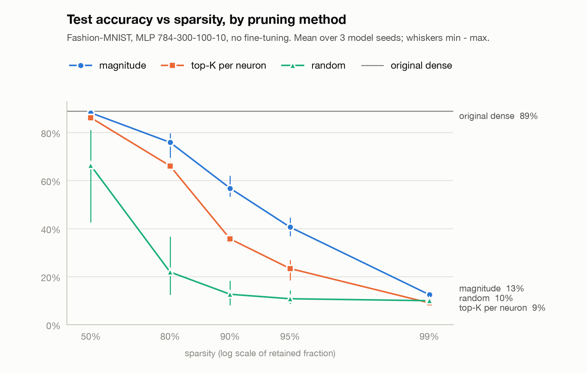
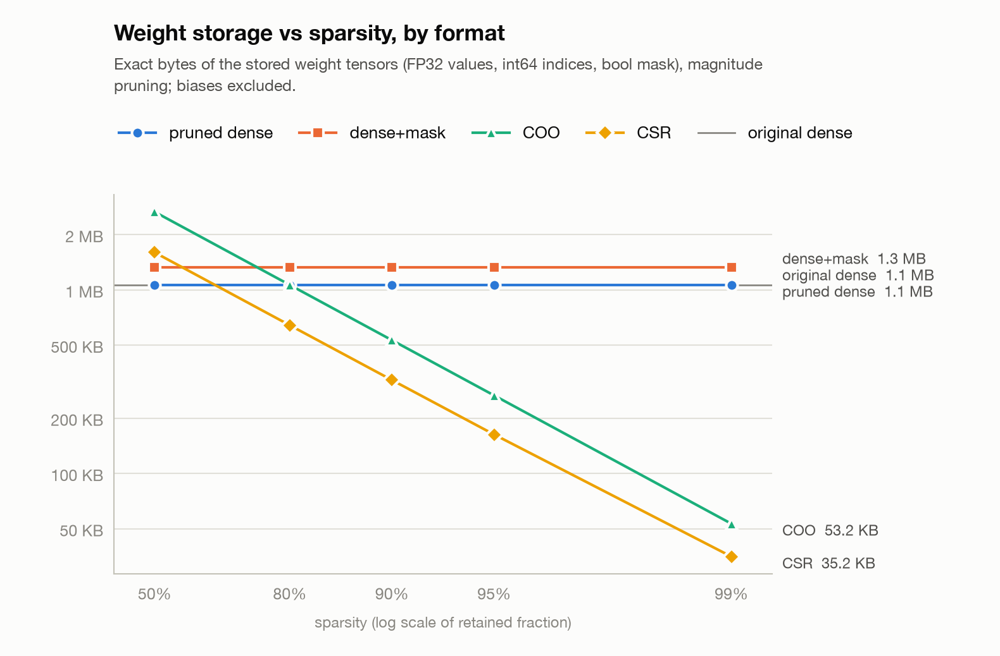

# MLP weight pruning: Fashion-MNIST, dense vs sparse weight storage

Results from `results/mlp/cuda1` on `cuda:1`. Model seeds: 42, 43, 44. Ranges in parentheses and chart whiskers are min - max over model seeds (and pruning seeds for random). No fine-tuning after pruning.

## Dense baseline

| Model seed | Best epoch | Val acc | Test acc |
|:---|---:|---:|---:|
| 42 | 27 | 89.50% | 88.87% |
| 43 | 26 | 89.14% | 89.15% |
| 44 | 14 | 89.28% | 88.96% |

Test accuracy over seeds: mean 88.99%, std 0.14 pp.

## Accuracy vs sparsity

| Method | Target | Actual | Test acc | Loss (pp) | Disagreement | Units |
|:---|---:|---:|---:|---:|---:|---:|
| original | 0% | 0% | 88.99% (88.87% - 89.15%) | - | - | 3 |
| magnitude | 50% | 50.00% | 88.25% (87.86% - 88.83%) | +0.75 (+0.13 - +1.29) | 4.67% (3.67% - 5.37%) | 3 |
| magnitude | 80% | 80.00% | 75.95% (69.79% - 79.54%) | +13.04 (+9.42 - +19.36) | 21.61% (17.99% - 27.67%) | 3 |
| magnitude | 90% | 90.00% | 56.86% (53.55% - 61.92%) | +32.14 (+27.04 - +35.60) | 42.16% (37.10% - 45.42%) | 3 |
| magnitude | 95% | 95.00% | 40.64% (37.18% - 44.45%) | +48.35 (+44.51 - +51.69) | 59.28% (55.53% - 63.01%) | 3 |
| magnitude | 99% | 99.00% | 12.51% (11.47% - 13.85%) | +76.49 (+75.11 - +77.68) | 87.56% (86.38% - 88.41%) | 3 |
| top-K per neuron | 50% | 50.00% | 86.24% (85.05% - 87.20%) | +2.75 (+1.67 - +4.10) | 8.24% (6.40% - 9.74%) | 3 |
| top-K per neuron | 80% | 79.98% | 66.13% (64.50% - 67.74%) | +22.86 (+21.22 - +24.65) | 32.19% (30.32% - 33.31%) | 3 |
| top-K per neuron | 90% | 89.93% | 35.74% (34.16% - 37.42%) | +53.26 (+51.73 - +54.71) | 64.26% (62.38% - 66.06%) | 3 |
| top-K per neuron | 95% | 94.91% | 23.40% (18.77% - 26.77%) | +65.60 (+62.19 - +70.10) | 76.58% (73.31% - 81.16%) | 3 |
| top-K per neuron | 99% | 98.98% | 9.10% (8.64% - 10.00%) | +79.90 (+79.15 - +80.32) | 90.94% (90.14% - 91.54%) | 3 |
| random | 50% | 50.00% | 66.32% (42.91% - 80.89%) | +22.67 (+8.07 - +46.24) | 31.40% (15.71% - 55.14%) | 9 |
| random | 80% | 80.00% | 21.94% (12.72% - 36.50%) | +67.05 (+52.46 - +76.43) | 77.71% (62.74% - 87.17%) | 9 |
| random | 90% | 90.00% | 12.69% (8.43% - 18.04%) | +76.31 (+70.92 - +80.53) | 87.30% (81.55% - 91.57%) | 9 |
| random | 95% | 95.00% | 10.81% (9.03% - 14.01%) | +78.18 (+74.95 - +79.93) | 89.30% (86.30% - 91.21%) | 9 |
| random | 99% | 99.00% | 10.00% | +78.99 (+78.87 - +79.15) | 90.06% (89.79% - 90.24%) | 9 |

Loss = original - pruned test accuracy in percentage points (negative = pruning helped). Disagreement = share of test images whose predicted class changed.

## Weight storage (bytes, % of original dense)

| Method | Sparsity | pruned dense | dense+mask | COO | CSR |
|:---|---:|---:|---:|---:|---:|
| magnitude | 50% | 1,064,800 (100.0%) | 1,331,000 (125.0%) | 2,662,000 (250.0%) | 1,600,504 (150.3%) |
| magnitude | 80% | 1,064,800 (100.0%) | 1,331,000 (125.0%) | 1,064,800 (100.0%) | 642,184 (60.3%) |
| magnitude | 90% | 1,064,800 (100.0%) | 1,331,000 (125.0%) | 532,400 (50.0%) | 322,744 (30.3%) |
| magnitude | 95% | 1,064,800 (100.0%) | 1,331,000 (125.0%) | 266,200 (25.0%) | 163,024 (15.3%) |
| magnitude | 99% | 1,064,800 (100.0%) | 1,331,000 (125.0%) | 53,240 (5.0%) | 35,248 (3.3%) |
| top-K per neuron | 50% | 1,064,800 (100.0%) | 1,331,000 (125.0%) | 2,662,000 (250.0%) | 1,600,504 (150.3%) |
| top-K per neuron | 80% | 1,064,800 (100.0%) | 1,331,000 (125.0%) | 1,066,000 (100.1%) | 642,904 (60.4%) |
| top-K per neuron | 90% | 1,064,800 (100.0%) | 1,331,000 (125.0%) | 536,000 (50.3%) | 324,904 (30.5%) |
| top-K per neuron | 95% | 1,064,800 (100.0%) | 1,331,000 (125.0%) | 271,000 (25.5%) | 165,904 (15.6%) |
| top-K per neuron | 99% | 1,064,800 (100.0%) | 1,331,000 (125.0%) | 54,200 (5.1%) | 35,824 (3.4%) |
| random | 50% | 1,064,800 (100.0%) | 1,331,000 (125.0%) | 2,662,000 (250.0%) | 1,600,504 (150.3%) |
| random | 80% | 1,064,800 (100.0%) | 1,331,000 (125.0%) | 1,064,800 (100.0%) | 642,184 (60.3%) |
| random | 90% | 1,064,800 (100.0%) | 1,331,000 (125.0%) | 532,400 (50.0%) | 322,744 (30.3%) |
| random | 95% | 1,064,800 (100.0%) | 1,331,000 (125.0%) | 266,200 (25.0%) | 163,024 (15.3%) |
| random | 99% | 1,064,800 (100.0%) | 1,331,000 (125.0%) | 53,240 (5.0%) | 35,248 (3.3%) |

Original dense weights: 1,064,800 bytes. Biases (1,640 bytes) are dense in every format.

## Latency (ms)

| Method | Sparsity | Format | Batch | Latency (ms) | Units | Reps |
|:---|---:|---:|---:|---:|---:|---:|
| original | 0% | dense | 1 | 0.1184 (0.1182 - 0.1186) | 3 | 3 |
| original | 0% | dense | 32 | 0.1326 (0.1314 - 0.1333) | 3 | 3 |
| original | 0% | dense | 256 | 0.1326 (0.1318 - 0.1333) | 3 | 3 |
| magnitude | 50% | pruned dense | 1 | 0.1175 (0.1172 - 0.1182) | 3 | 3 |
| magnitude | 50% | dense+mask | 1 | 0.1608 (0.1602 - 0.1611) | 3 | 3 |
| magnitude | 50% | COO | 1 | 0.5163 (0.5145 - 0.5186) | 3 | 3 |
| magnitude | 50% | CSR | 1 | 0.2646 (0.2638 - 0.2656) | 3 | 3 |
| magnitude | 80% | pruned dense | 1 | 0.1191 (0.1180 - 0.1204) | 3 | 3 |
| magnitude | 80% | dense+mask | 1 | 0.1609 (0.1606 - 0.1615) | 3 | 3 |
| magnitude | 80% | COO | 1 | 0.5151 (0.5135 - 0.5159) | 3 | 3 |
| magnitude | 80% | CSR | 1 | 0.2625 (0.2618 - 0.2638) | 3 | 3 |
| magnitude | 90% | pruned dense | 1 | 0.1177 (0.1171 - 0.1183) | 3 | 3 |
| magnitude | 90% | dense+mask | 1 | 0.1609 (0.1595 - 0.1617) | 3 | 3 |
| magnitude | 90% | COO | 1 | 0.5128 (0.5102 - 0.5151) | 3 | 3 |
| magnitude | 90% | CSR | 1 | 0.2638 (0.2631 - 0.2647) | 3 | 3 |
| magnitude | 95% | pruned dense | 1 | 0.1183 (0.1179 - 0.1187) | 3 | 3 |
| magnitude | 95% | dense+mask | 1 | 0.1608 (0.1602 - 0.1619) | 3 | 3 |
| magnitude | 95% | COO | 1 | 0.5162 (0.5126 - 0.5188) | 3 | 3 |
| magnitude | 95% | CSR | 1 | 0.2631 (0.2602 - 0.2648) | 3 | 3 |
| magnitude | 99% | pruned dense | 1 | 0.1174 (0.1170 - 0.1177) | 3 | 3 |
| magnitude | 99% | dense+mask | 1 | 0.1606 (0.1601 - 0.1610) | 3 | 3 |
| magnitude | 99% | COO | 1 | 0.5134 (0.5119 - 0.5152) | 3 | 3 |
| magnitude | 99% | CSR | 1 | 0.2636 (0.2618 - 0.2659) | 3 | 3 |
| magnitude | 50% | pruned dense | 32 | 0.1325 (0.1323 - 0.1329) | 3 | 3 |
| magnitude | 50% | dense+mask | 32 | 0.1756 (0.1746 - 0.1766) | 3 | 3 |
| magnitude | 50% | COO | 32 | 0.5131 (0.5117 - 0.5155) | 3 | 3 |
| magnitude | 50% | CSR | 32 | 0.2708 (0.2691 - 0.2723) | 3 | 3 |
| magnitude | 80% | pruned dense | 32 | 0.1323 (0.1317 - 0.1327) | 3 | 3 |
| magnitude | 80% | dense+mask | 32 | 0.1755 (0.1754 - 0.1755) | 3 | 3 |
| magnitude | 80% | COO | 32 | 0.5183 (0.5170 - 0.5202) | 3 | 3 |
| magnitude | 80% | CSR | 32 | 0.2699 (0.2694 - 0.2704) | 3 | 3 |
| magnitude | 90% | pruned dense | 32 | 0.1321 (0.1316 - 0.1328) | 3 | 3 |
| magnitude | 90% | dense+mask | 32 | 0.1754 (0.1739 - 0.1763) | 3 | 3 |
| magnitude | 90% | COO | 32 | 0.5167 (0.5160 - 0.5177) | 3 | 3 |
| magnitude | 90% | CSR | 32 | 0.2738 (0.2736 - 0.2742) | 3 | 3 |
| magnitude | 95% | pruned dense | 32 | 0.1328 (0.1319 - 0.1333) | 3 | 3 |
| magnitude | 95% | dense+mask | 32 | 0.1752 (0.1743 - 0.1765) | 3 | 3 |
| magnitude | 95% | COO | 32 | 0.5146 (0.5125 - 0.5171) | 3 | 3 |
| magnitude | 95% | CSR | 32 | 0.2719 (0.2704 - 0.2741) | 3 | 3 |
| magnitude | 99% | pruned dense | 32 | 0.1334 (0.1320 - 0.1351) | 3 | 3 |
| magnitude | 99% | dense+mask | 32 | 0.1755 (0.1748 - 0.1768) | 3 | 3 |
| magnitude | 99% | COO | 32 | 0.5163 (0.5141 - 0.5183) | 3 | 3 |
| magnitude | 99% | CSR | 32 | 0.2713 (0.2705 - 0.2719) | 3 | 3 |
| magnitude | 50% | pruned dense | 256 | 0.1329 (0.1326 - 0.1333) | 3 | 3 |
| magnitude | 50% | dense+mask | 256 | 0.1745 (0.1742 - 0.1747) | 3 | 3 |
| magnitude | 50% | COO | 256 | 0.5212 (0.5201 - 0.5225) | 3 | 3 |
| magnitude | 50% | CSR | 256 | 0.4479 (0.4453 - 0.4495) | 3 | 3 |
| magnitude | 80% | pruned dense | 256 | 0.1324 (0.1322 - 0.1326) | 3 | 3 |
| magnitude | 80% | dense+mask | 256 | 0.1739 (0.1729 - 0.1746) | 3 | 3 |
| magnitude | 80% | COO | 256 | 0.5188 (0.5175 - 0.5208) | 3 | 3 |
| magnitude | 80% | CSR | 256 | 0.2743 (0.2736 - 0.2749) | 3 | 3 |
| magnitude | 90% | pruned dense | 256 | 0.1320 (0.1315 - 0.1326) | 3 | 3 |
| magnitude | 90% | dense+mask | 256 | 0.1743 (0.1738 - 0.1752) | 3 | 3 |
| magnitude | 90% | COO | 256 | 0.5241 (0.5226 - 0.5264) | 3 | 3 |
| magnitude | 90% | CSR | 256 | 0.2722 (0.2708 - 0.2747) | 3 | 3 |
| magnitude | 95% | pruned dense | 256 | 0.1334 (0.1318 - 0.1350) | 3 | 3 |
| magnitude | 95% | dense+mask | 256 | 0.1744 (0.1737 - 0.1752) | 3 | 3 |
| magnitude | 95% | COO | 256 | 0.5158 (0.5139 - 0.5174) | 3 | 3 |
| magnitude | 95% | CSR | 256 | 0.2729 (0.2696 - 0.2748) | 3 | 3 |
| magnitude | 99% | pruned dense | 256 | 0.1327 (0.1322 - 0.1331) | 3 | 3 |
| magnitude | 99% | dense+mask | 256 | 0.1748 (0.1740 - 0.1756) | 3 | 3 |
| magnitude | 99% | COO | 256 | 0.5156 (0.5141 - 0.5166) | 3 | 3 |
| magnitude | 99% | CSR | 256 | 0.2731 (0.2717 - 0.2743) | 3 | 3 |
| top-K per neuron | 50% | pruned dense | 1 | 0.1177 (0.1172 - 0.1181) | 3 | 3 |
| top-K per neuron | 50% | dense+mask | 1 | 0.1612 (0.1606 - 0.1616) | 3 | 3 |
| top-K per neuron | 50% | COO | 1 | 0.5127 (0.5103 - 0.5164) | 3 | 3 |
| top-K per neuron | 50% | CSR | 1 | 0.2625 (0.2620 - 0.2629) | 3 | 3 |
| top-K per neuron | 80% | pruned dense | 1 | 0.1176 (0.1175 - 0.1176) | 3 | 3 |
| top-K per neuron | 80% | dense+mask | 1 | 0.1615 (0.1609 - 0.1618) | 3 | 3 |
| top-K per neuron | 80% | COO | 1 | 0.5170 (0.5153 - 0.5194) | 3 | 3 |
| top-K per neuron | 80% | CSR | 1 | 0.2621 (0.2601 - 0.2639) | 3 | 3 |
| top-K per neuron | 90% | pruned dense | 1 | 0.1175 (0.1166 - 0.1184) | 3 | 3 |
| top-K per neuron | 90% | dense+mask | 1 | 0.1608 (0.1602 - 0.1615) | 3 | 3 |
| top-K per neuron | 90% | COO | 1 | 0.5147 (0.5122 - 0.5169) | 3 | 3 |
| top-K per neuron | 90% | CSR | 1 | 0.2624 (0.2620 - 0.2629) | 3 | 3 |
| top-K per neuron | 95% | pruned dense | 1 | 0.1176 (0.1169 - 0.1188) | 3 | 3 |
| top-K per neuron | 95% | dense+mask | 1 | 0.1611 (0.1606 - 0.1615) | 3 | 3 |
| top-K per neuron | 95% | COO | 1 | 0.5140 (0.5129 - 0.5150) | 3 | 3 |
| top-K per neuron | 95% | CSR | 1 | 0.2618 (0.2599 - 0.2633) | 3 | 3 |
| top-K per neuron | 99% | pruned dense | 1 | 0.1176 (0.1168 - 0.1180) | 3 | 3 |
| top-K per neuron | 99% | dense+mask | 1 | 0.1614 (0.1603 - 0.1625) | 3 | 3 |
| top-K per neuron | 99% | COO | 1 | 0.5131 (0.5112 - 0.5142) | 3 | 3 |
| top-K per neuron | 99% | CSR | 1 | 0.2615 (0.2602 - 0.2627) | 3 | 3 |
| top-K per neuron | 50% | pruned dense | 32 | 0.1322 (0.1314 - 0.1327) | 3 | 3 |
| top-K per neuron | 50% | dense+mask | 32 | 0.1751 (0.1741 - 0.1762) | 3 | 3 |
| top-K per neuron | 50% | COO | 32 | 0.5152 (0.5138 - 0.5176) | 3 | 3 |
| top-K per neuron | 50% | CSR | 32 | 0.2728 (0.2721 - 0.2734) | 3 | 3 |
| top-K per neuron | 80% | pruned dense | 32 | 0.1318 (0.1313 - 0.1328) | 3 | 3 |
| top-K per neuron | 80% | dense+mask | 32 | 0.1764 (0.1759 - 0.1766) | 3 | 3 |
| top-K per neuron | 80% | COO | 32 | 0.5166 (0.5160 - 0.5176) | 3 | 3 |
| top-K per neuron | 80% | CSR | 32 | 0.2732 (0.2719 - 0.2741) | 3 | 3 |
| top-K per neuron | 90% | pruned dense | 32 | 0.1321 (0.1316 - 0.1328) | 3 | 3 |
| top-K per neuron | 90% | dense+mask | 32 | 0.1758 (0.1750 - 0.1766) | 3 | 3 |
| top-K per neuron | 90% | COO | 32 | 0.5158 (0.5126 - 0.5184) | 3 | 3 |
| top-K per neuron | 90% | CSR | 32 | 0.2726 (0.2711 - 0.2733) | 3 | 3 |
| top-K per neuron | 95% | pruned dense | 32 | 0.1324 (0.1323 - 0.1324) | 3 | 3 |
| top-K per neuron | 95% | dense+mask | 32 | 0.1759 (0.1754 - 0.1763) | 3 | 3 |
| top-K per neuron | 95% | COO | 32 | 0.5148 (0.5128 - 0.5177) | 3 | 3 |
| top-K per neuron | 95% | CSR | 32 | 0.2709 (0.2695 - 0.2733) | 3 | 3 |
| top-K per neuron | 99% | pruned dense | 32 | 0.1319 (0.1313 - 0.1324) | 3 | 3 |
| top-K per neuron | 99% | dense+mask | 32 | 0.1763 (0.1754 - 0.1772) | 3 | 3 |
| top-K per neuron | 99% | COO | 32 | 0.5165 (0.5146 - 0.5194) | 3 | 3 |
| top-K per neuron | 99% | CSR | 32 | 0.2713 (0.2698 - 0.2724) | 3 | 3 |
| top-K per neuron | 50% | pruned dense | 256 | 0.1320 (0.1317 - 0.1323) | 3 | 3 |
| top-K per neuron | 50% | dense+mask | 256 | 0.1741 (0.1736 - 0.1744) | 3 | 3 |
| top-K per neuron | 50% | COO | 256 | 0.5197 (0.5161 - 0.5262) | 3 | 3 |
| top-K per neuron | 50% | CSR | 256 | 0.4512 (0.4510 - 0.4514) | 3 | 3 |
| top-K per neuron | 80% | pruned dense | 256 | 0.1319 (0.1311 - 0.1324) | 3 | 3 |
| top-K per neuron | 80% | dense+mask | 256 | 0.1740 (0.1731 - 0.1745) | 3 | 3 |
| top-K per neuron | 80% | COO | 256 | 0.5207 (0.5186 - 0.5223) | 3 | 3 |
| top-K per neuron | 80% | CSR | 256 | 0.2736 (0.2729 - 0.2746) | 3 | 3 |
| top-K per neuron | 90% | pruned dense | 256 | 0.1327 (0.1313 - 0.1339) | 3 | 3 |
| top-K per neuron | 90% | dense+mask | 256 | 0.1745 (0.1741 - 0.1751) | 3 | 3 |
| top-K per neuron | 90% | COO | 256 | 0.5233 (0.5198 - 0.5254) | 3 | 3 |
| top-K per neuron | 90% | CSR | 256 | 0.2724 (0.2693 - 0.2764) | 3 | 3 |
| top-K per neuron | 95% | pruned dense | 256 | 0.1325 (0.1320 - 0.1330) | 3 | 3 |
| top-K per neuron | 95% | dense+mask | 256 | 0.1738 (0.1736 - 0.1738) | 3 | 3 |
| top-K per neuron | 95% | COO | 256 | 0.5149 (0.5140 - 0.5157) | 3 | 3 |
| top-K per neuron | 95% | CSR | 256 | 0.2724 (0.2712 - 0.2742) | 3 | 3 |
| top-K per neuron | 99% | pruned dense | 256 | 0.1327 (0.1324 - 0.1330) | 3 | 3 |
| top-K per neuron | 99% | dense+mask | 256 | 0.1753 (0.1745 - 0.1761) | 3 | 3 |
| top-K per neuron | 99% | COO | 256 | 0.5183 (0.5171 - 0.5203) | 3 | 3 |
| top-K per neuron | 99% | CSR | 256 | 0.2733 (0.2718 - 0.2744) | 3 | 3 |
| random | 50% | pruned dense | 1 | 0.1179 (0.1169 - 0.1188) | 3 | 3 |
| random | 50% | dense+mask | 1 | 0.1600 (0.1596 - 0.1603) | 3 | 3 |
| random | 50% | COO | 1 | 0.5167 (0.5152 - 0.5188) | 3 | 3 |
| random | 50% | CSR | 1 | 0.2633 (0.2629 - 0.2640) | 3 | 3 |
| random | 80% | pruned dense | 1 | 0.1183 (0.1176 - 0.1190) | 3 | 3 |
| random | 80% | dense+mask | 1 | 0.1609 (0.1593 - 0.1625) | 3 | 3 |
| random | 80% | COO | 1 | 0.5144 (0.5113 - 0.5187) | 3 | 3 |
| random | 80% | CSR | 1 | 0.2648 (0.2643 - 0.2653) | 3 | 3 |
| random | 90% | pruned dense | 1 | 0.1174 (0.1162 - 0.1183) | 3 | 3 |
| random | 90% | dense+mask | 1 | 0.1613 (0.1601 - 0.1628) | 3 | 3 |
| random | 90% | COO | 1 | 0.5139 (0.5129 - 0.5149) | 3 | 3 |
| random | 90% | CSR | 1 | 0.2629 (0.2620 - 0.2648) | 3 | 3 |
| random | 95% | pruned dense | 1 | 0.1175 (0.1168 - 0.1180) | 3 | 3 |
| random | 95% | dense+mask | 1 | 0.1609 (0.1598 - 0.1621) | 3 | 3 |
| random | 95% | COO | 1 | 0.5135 (0.5121 - 0.5157) | 3 | 3 |
| random | 95% | CSR | 1 | 0.2619 (0.2602 - 0.2629) | 3 | 3 |
| random | 99% | pruned dense | 1 | 0.1175 (0.1170 - 0.1185) | 3 | 3 |
| random | 99% | dense+mask | 1 | 0.1607 (0.1606 - 0.1608) | 3 | 3 |
| random | 99% | COO | 1 | 0.5165 (0.5138 - 0.5182) | 3 | 3 |
| random | 99% | CSR | 1 | 0.2630 (0.2608 - 0.2657) | 3 | 3 |
| random | 50% | pruned dense | 32 | 0.1333 (0.1325 - 0.1342) | 3 | 3 |
| random | 50% | dense+mask | 32 | 0.1754 (0.1751 - 0.1757) | 3 | 3 |
| random | 50% | COO | 32 | 0.5185 (0.5144 - 0.5220) | 3 | 3 |
| random | 50% | CSR | 32 | 0.2717 (0.2704 - 0.2737) | 3 | 3 |
| random | 80% | pruned dense | 32 | 0.1322 (0.1316 - 0.1328) | 3 | 3 |
| random | 80% | dense+mask | 32 | 0.1760 (0.1743 - 0.1792) | 3 | 3 |
| random | 80% | COO | 32 | 0.5178 (0.5170 - 0.5188) | 3 | 3 |
| random | 80% | CSR | 32 | 0.2724 (0.2706 - 0.2741) | 3 | 3 |
| random | 90% | pruned dense | 32 | 0.1326 (0.1320 - 0.1330) | 3 | 3 |
| random | 90% | dense+mask | 32 | 0.1757 (0.1754 - 0.1762) | 3 | 3 |
| random | 90% | COO | 32 | 0.5163 (0.5130 - 0.5193) | 3 | 3 |
| random | 90% | CSR | 32 | 0.2715 (0.2688 - 0.2739) | 3 | 3 |
| random | 95% | pruned dense | 32 | 0.1321 (0.1312 - 0.1331) | 3 | 3 |
| random | 95% | dense+mask | 32 | 0.1759 (0.1756 - 0.1761) | 3 | 3 |
| random | 95% | COO | 32 | 0.5185 (0.5173 - 0.5195) | 3 | 3 |
| random | 95% | CSR | 32 | 0.2725 (0.2719 - 0.2734) | 3 | 3 |
| random | 99% | pruned dense | 32 | 0.1330 (0.1324 - 0.1336) | 3 | 3 |
| random | 99% | dense+mask | 32 | 0.1766 (0.1758 - 0.1782) | 3 | 3 |
| random | 99% | COO | 32 | 0.5141 (0.5119 - 0.5154) | 3 | 3 |
| random | 99% | CSR | 32 | 0.2721 (0.2700 - 0.2735) | 3 | 3 |
| random | 50% | pruned dense | 256 | 0.1328 (0.1326 - 0.1329) | 3 | 3 |
| random | 50% | dense+mask | 256 | 0.1738 (0.1734 - 0.1743) | 3 | 3 |
| random | 50% | COO | 256 | 0.5213 (0.5200 - 0.5228) | 3 | 3 |
| random | 50% | CSR | 256 | 0.4525 (0.4521 - 0.4532) | 3 | 3 |
| random | 80% | pruned dense | 256 | 0.1333 (0.1322 - 0.1342) | 3 | 3 |
| random | 80% | dense+mask | 256 | 0.1733 (0.1729 - 0.1740) | 3 | 3 |
| random | 80% | COO | 256 | 0.5196 (0.5181 - 0.5205) | 3 | 3 |
| random | 80% | CSR | 256 | 0.2749 (0.2724 - 0.2781) | 3 | 3 |
| random | 90% | pruned dense | 256 | 0.1335 (0.1333 - 0.1337) | 3 | 3 |
| random | 90% | dense+mask | 256 | 0.1744 (0.1741 - 0.1745) | 3 | 3 |
| random | 90% | COO | 256 | 0.5186 (0.5175 - 0.5200) | 3 | 3 |
| random | 90% | CSR | 256 | 0.2720 (0.2713 - 0.2732) | 3 | 3 |
| random | 95% | pruned dense | 256 | 0.1328 (0.1324 - 0.1332) | 3 | 3 |
| random | 95% | dense+mask | 256 | 0.1745 (0.1736 - 0.1755) | 3 | 3 |
| random | 95% | COO | 256 | 0.5153 (0.5140 - 0.5162) | 3 | 3 |
| random | 95% | CSR | 256 | 0.2726 (0.2719 - 0.2733) | 3 | 3 |
| random | 99% | pruned dense | 256 | 0.1323 (0.1319 - 0.1328) | 3 | 3 |
| random | 99% | dense+mask | 256 | 0.1744 (0.1737 - 0.1748) | 3 | 3 |
| random | 99% | COO | 256 | 0.5162 (0.5154 - 0.5168) | 3 | 3 |
| random | 99% | CSR | 256 | 0.2732 (0.2717 - 0.2749) | 3 | 3 |

Per unit: median of per-repetition medians (50 timed passes each); mean over units, whiskers min - max. Charts: latency_vs_sparsity_<method>.png.

## Total peak GPU memory

| Method | Sparsity | Format | Batch | Resident before inference | Peak allocated | Peak - resident |
|:---|---:|---:|---:|---:|---:|---:|
| original | 0% | dense | 1 | 1.1 MB | 9.6 MB | 8.5 MB |
| original | 0% | dense | 32 | 1.2 MB | 9.8 MB | 8.6 MB |
| original | 0% | dense | 256 | 1.9 MB | 11 MB | 9.1 MB |
| magnitude | 50% | pruned dense | 1 | 1.1 MB | 9.6 MB | 8.5 MB |
| magnitude | 50% | dense+mask | 1 | 1.3 MB | 10.9 MB | 9.6 MB |
| magnitude | 50% | COO | 1 | 2.7 MB (2.7 MB - 2.7 MB) | 3.1 MB (3.1 MB - 3.1 MB) | 469.7 KB (468 KB - 471 KB) |
| magnitude | 50% | CSR | 1 | 1.6 MB | 1.6 MB | 4.6 KB |
| magnitude | 80% | pruned dense | 1 | 1.1 MB | 9.6 MB | 8.5 MB |
| magnitude | 80% | dense+mask | 1 | 1.3 MB | 10.9 MB | 9.6 MB |
| magnitude | 80% | COO | 1 | 1.1 MB (1.1 MB - 1.1 MB) | 1.3 MB (1.3 MB - 1.3 MB) | 188.9 KB (187.9 KB - 189.4 KB) |
| magnitude | 80% | CSR | 1 | 650.9 KB (650.2 KB - 651.3 KB) | 655 KB (654.3 KB - 655.4 KB) | 4.1 KB |
| magnitude | 90% | pruned dense | 1 | 1.1 MB | 9.6 MB | 8.5 MB |
| magnitude | 90% | dense+mask | 1 | 1.3 MB | 10.9 MB | 9.6 MB |
| magnitude | 90% | COO | 1 | 540 KB (539.1 KB - 540.7 KB) | 636.9 KB (635.9 KB - 637.4 KB) | 96.9 KB (96.8 KB - 97.3 KB) |
| magnitude | 90% | CSR | 1 | 331.4 KB (330.8 KB - 331.8 KB) | 335.5 KB (334.8 KB - 335.9 KB) | 4.1 KB |
| magnitude | 95% | pruned dense | 1 | 1.1 MB | 9.6 MB | 8.5 MB |
| magnitude | 95% | dense+mask | 1 | 1.3 MB | 10.9 MB | 9.6 MB |
| magnitude | 95% | COO | 1 | 273.7 KB (273.4 KB - 274.4 KB) | 325.3 KB (324.6 KB - 326.1 KB) | 51.5 KB (51.2 KB - 51.7 KB) |
| magnitude | 95% | CSR | 1 | 171.3 KB (171 KB - 172 KB) | 175.4 KB (175.1 KB - 176.1 KB) | 4.1 KB |
| magnitude | 99% | pruned dense | 1 | 1.1 MB | 9.6 MB | 8.5 MB |
| magnitude | 99% | dense+mask | 1 | 1.3 MB | 10.9 MB | 9.6 MB |
| magnitude | 99% | COO | 1 | 60.8 KB (60.4 KB - 60.9 KB) | 76.8 KB | 16 KB (15.9 KB - 16.4 KB) |
| magnitude | 99% | CSR | 1 | 43.5 KB | 47.6 KB | 4.1 KB |
| magnitude | 50% | pruned dense | 32 | 1.2 MB | 9.8 MB | 8.6 MB |
| magnitude | 50% | dense+mask | 32 | 1.4 MB | 11.1 MB | 9.6 MB |
| magnitude | 50% | COO | 32 | 2.8 MB (2.8 MB - 2.8 MB) | 3.3 MB (3.3 MB - 3.4 MB) | 582.8 KB (581.1 KB - 584.2 KB) |
| magnitude | 50% | CSR | 32 | 1.7 MB | 1.8 MB (1.8 MB - 1.8 MB) | 117.1 KB (116.7 KB - 117.2 KB) |
| magnitude | 80% | pruned dense | 32 | 1.2 MB | 9.8 MB | 8.6 MB |
| magnitude | 80% | dense+mask | 32 | 1.4 MB | 11.1 MB | 9.6 MB |
| magnitude | 80% | COO | 32 | 1.2 MB (1.2 MB - 1.2 MB) | 1.5 MB (1.5 MB - 1.5 MB) | 301.1 KB (300 KB - 301.6 KB) |
| magnitude | 80% | CSR | 32 | 747.7 KB (747 KB - 748 KB) | 841.4 KB (840.7 KB - 841.7 KB) | 93.7 KB |
| magnitude | 90% | pruned dense | 32 | 1.2 MB | 9.8 MB | 8.6 MB |
| magnitude | 90% | dense+mask | 32 | 1.4 MB | 11.1 MB | 9.6 MB |
| magnitude | 90% | COO | 32 | 636.8 KB (635.9 KB - 637.4 KB) | 845.3 KB (844.3 KB - 845.8 KB) | 208.6 KB (208.4 KB - 208.9 KB) |
| magnitude | 90% | CSR | 32 | 428.2 KB (427.5 KB - 428.5 KB) | 514.2 KB (513.5 KB - 514.6 KB) | 86 KB |
| magnitude | 95% | pruned dense | 32 | 1.2 MB | 9.8 MB | 8.6 MB |
| magnitude | 95% | dense+mask | 32 | 1.4 MB | 11.1 MB | 9.6 MB |
| magnitude | 95% | COO | 32 | 370.5 KB (370.2 KB - 371.2 KB) | 533.7 KB (533 KB - 534.5 KB) | 163.2 KB (162.8 KB - 163.3 KB) |
| magnitude | 95% | CSR | 32 | 268.1 KB (267.8 KB - 268.8 KB) | 350.5 KB (350.2 KB - 351.2 KB) | 82.4 KB |
| magnitude | 99% | pruned dense | 32 | 1.2 MB | 9.8 MB | 8.6 MB |
| magnitude | 99% | dense+mask | 32 | 1.4 MB | 11.1 MB | 9.6 MB |
| magnitude | 99% | COO | 32 | 157.5 KB (157.2 KB - 157.7 KB) | 285.2 KB | 127.7 KB (127.5 KB - 128 KB) |
| magnitude | 99% | CSR | 32 | 140.3 KB | 219.6 KB | 79.4 KB |
| magnitude | 50% | pruned dense | 256 | 1.9 MB | 11 MB | 9.1 MB |
| magnitude | 50% | dense+mask | 256 | 2.1 MB | 12.2 MB | 10.1 MB |
| magnitude | 50% | COO | 256 | 3.5 MB (3.5 MB - 3.5 MB) | 4.9 MB (4.9 MB - 4.9 MB) | 1.4 MB (1.4 MB - 1.4 MB) |
| magnitude | 50% | CSR | 256 | 2.4 MB | 3.1 MB (3.1 MB - 3.1 MB) | 663.4 KB (663 KB - 663.6 KB) |
| magnitude | 80% | pruned dense | 256 | 1.9 MB | 11 MB | 9.1 MB |
| magnitude | 80% | dense+mask | 256 | 2.1 MB | 12.2 MB | 10.1 MB |
| magnitude | 80% | COO | 256 | 1.9 MB (1.9 MB - 1.9 MB) | 3 MB (3 MB - 3 MB) | 1.1 MB (1.1 MB - 1.1 MB) |
| magnitude | 80% | CSR | 256 | 1.5 MB (1.4 MB - 1.5 MB) | 2.1 MB (2.1 MB - 2.1 MB) | 640 KB |
| magnitude | 90% | pruned dense | 256 | 1.9 MB | 11 MB | 9.1 MB |
| magnitude | 90% | dense+mask | 256 | 2.1 MB | 12.2 MB | 10.1 MB |
| magnitude | 90% | COO | 256 | 1.3 MB (1.3 MB - 1.3 MB) | 2.4 MB (2.4 MB - 2.4 MB) | 1 MB (1 MB - 1 MB) |
| magnitude | 90% | CSR | 256 | 1.1 MB (1.1 MB - 1.1 MB) | 1.8 MB (1.8 MB - 1.8 MB) | 632.3 KB |
| magnitude | 95% | pruned dense | 256 | 1.9 MB | 11 MB | 9.1 MB |
| magnitude | 95% | dense+mask | 256 | 2.1 MB | 12.2 MB | 10.1 MB |
| magnitude | 95% | COO | 256 | 1.1 MB (1.1 MB - 1.1 MB) | 2.1 MB (2.1 MB - 2.1 MB) | 978.3 KB (977.9 KB - 978.4 KB) |
| magnitude | 95% | CSR | 256 | 970.6 KB (970.2 KB - 971.3 KB) | 1.6 MB (1.6 MB - 1.6 MB) | 628.7 KB |
| magnitude | 99% | pruned dense | 256 | 1.9 MB | 11 MB | 9.1 MB |
| magnitude | 99% | dense+mask | 256 | 2.1 MB | 12.2 MB | 10.1 MB |
| magnitude | 99% | COO | 256 | 860 KB (859.6 KB - 860.2 KB) | 1.8 MB | 942.8 KB (942.6 KB - 943.1 KB) |
| magnitude | 99% | CSR | 256 | 842.8 KB | 1.5 MB | 625.7 KB |
| top-K per neuron | 50% | pruned dense | 1 | 1.1 MB | 9.6 MB | 8.5 MB |
| top-K per neuron | 50% | dense+mask | 1 | 1.3 MB | 10.9 MB | 9.6 MB |
| top-K per neuron | 50% | COO | 1 | 2.7 MB | 3.1 MB | 477.7 KB |
| top-K per neuron | 50% | CSR | 1 | 1.6 MB | 1.6 MB | 4.6 KB |
| top-K per neuron | 80% | pruned dense | 1 | 1.1 MB | 9.6 MB | 8.5 MB |
| top-K per neuron | 80% | dense+mask | 1 | 1.3 MB | 10.9 MB | 9.6 MB |
| top-K per neuron | 80% | COO | 1 | 1.1 MB | 1.3 MB | 195.6 KB |
| top-K per neuron | 80% | CSR | 1 | 650.8 KB | 654.8 KB | 4.1 KB |
| top-K per neuron | 90% | pruned dense | 1 | 1.1 MB | 9.6 MB | 8.5 MB |
| top-K per neuron | 90% | dense+mask | 1 | 1.3 MB | 10.9 MB | 9.6 MB |
| top-K per neuron | 90% | COO | 1 | 543.7 KB | 646.1 KB | 102.4 KB |
| top-K per neuron | 90% | CSR | 1 | 333.3 KB | 337.4 KB | 4.1 KB |
| top-K per neuron | 95% | pruned dense | 1 | 1.1 MB | 9.6 MB | 8.5 MB |
| top-K per neuron | 95% | dense+mask | 1 | 1.3 MB | 10.9 MB | 9.6 MB |
| top-K per neuron | 95% | COO | 1 | 278 KB | 333.3 KB | 55.3 KB |
| top-K per neuron | 95% | CSR | 1 | 174.1 KB | 178.2 KB | 4.1 KB |
| top-K per neuron | 99% | pruned dense | 1 | 1.1 MB | 9.6 MB | 8.5 MB |
| top-K per neuron | 99% | dense+mask | 1 | 1.3 MB | 10.9 MB | 9.6 MB |
| top-K per neuron | 99% | COO | 1 | 62 KB | 78.8 KB | 16.9 KB |
| top-K per neuron | 99% | CSR | 1 | 44.5 KB | 48.6 KB | 4.1 KB |
| top-K per neuron | 50% | pruned dense | 32 | 1.2 MB | 9.8 MB | 8.6 MB |
| top-K per neuron | 50% | dense+mask | 32 | 1.4 MB | 11.1 MB | 9.6 MB |
| top-K per neuron | 50% | COO | 32 | 2.8 MB | 3.4 MB | 590.8 KB |
| top-K per neuron | 50% | CSR | 32 | 1.7 MB | 1.8 MB | 117.8 KB |
| top-K per neuron | 80% | pruned dense | 32 | 1.2 MB | 9.8 MB | 8.6 MB |
| top-K per neuron | 80% | dense+mask | 32 | 1.4 MB | 11.1 MB | 9.6 MB |
| top-K per neuron | 80% | COO | 32 | 1.2 MB | 1.5 MB | 307.7 KB |
| top-K per neuron | 80% | CSR | 32 | 747.5 KB | 841.7 KB | 94.2 KB |
| top-K per neuron | 90% | pruned dense | 32 | 1.2 MB | 9.8 MB | 8.6 MB |
| top-K per neuron | 90% | dense+mask | 32 | 1.4 MB | 11.1 MB | 9.6 MB |
| top-K per neuron | 90% | COO | 32 | 640.5 KB | 854.5 KB | 214 KB |
| top-K per neuron | 90% | CSR | 32 | 430.1 KB | 516.6 KB | 86.5 KB |
| top-K per neuron | 95% | pruned dense | 32 | 1.2 MB | 9.8 MB | 8.6 MB |
| top-K per neuron | 95% | dense+mask | 32 | 1.4 MB | 11.1 MB | 9.6 MB |
| top-K per neuron | 95% | COO | 32 | 374.8 KB | 541.7 KB | 166.9 KB |
| top-K per neuron | 95% | CSR | 32 | 270.8 KB | 353.3 KB | 82.4 KB |
| top-K per neuron | 99% | pruned dense | 32 | 1.2 MB | 9.8 MB | 8.6 MB |
| top-K per neuron | 99% | dense+mask | 32 | 1.4 MB | 11.1 MB | 9.6 MB |
| top-K per neuron | 99% | COO | 32 | 158.7 KB | 287.2 KB | 128.5 KB |
| top-K per neuron | 99% | CSR | 32 | 141.3 KB | 220.7 KB | 79.4 KB |
| top-K per neuron | 50% | pruned dense | 256 | 1.9 MB | 11 MB | 9.1 MB |
| top-K per neuron | 50% | dense+mask | 256 | 2.1 MB | 12.2 MB | 10.1 MB |
| top-K per neuron | 50% | COO | 256 | 3.5 MB | 4.9 MB | 1.4 MB |
| top-K per neuron | 50% | CSR | 256 | 2.4 MB | 3.1 MB | 664.1 KB |
| top-K per neuron | 80% | pruned dense | 256 | 1.9 MB | 11 MB | 9.1 MB |
| top-K per neuron | 80% | dense+mask | 256 | 2.1 MB | 12.2 MB | 10.1 MB |
| top-K per neuron | 80% | COO | 256 | 1.9 MB | 3 MB | 1.1 MB |
| top-K per neuron | 80% | CSR | 256 | 1.4 MB | 2.1 MB | 640.5 KB |
| top-K per neuron | 90% | pruned dense | 256 | 1.9 MB | 11 MB | 9.1 MB |
| top-K per neuron | 90% | dense+mask | 256 | 2.1 MB | 12.2 MB | 10.1 MB |
| top-K per neuron | 90% | COO | 256 | 1.3 MB | 2.4 MB | 1 MB |
| top-K per neuron | 90% | CSR | 256 | 1.1 MB | 1.8 MB | 632.8 KB |
| top-K per neuron | 95% | pruned dense | 256 | 1.9 MB | 11 MB | 9.1 MB |
| top-K per neuron | 95% | dense+mask | 256 | 2.1 MB | 12.2 MB | 10.1 MB |
| top-K per neuron | 95% | COO | 256 | 1.1 MB | 2.1 MB | 982 KB |
| top-K per neuron | 95% | CSR | 256 | 973.3 KB | 1.6 MB | 628.7 KB |
| top-K per neuron | 99% | pruned dense | 256 | 1.9 MB | 11 MB | 9.1 MB |
| top-K per neuron | 99% | dense+mask | 256 | 2.1 MB | 12.2 MB | 10.1 MB |
| top-K per neuron | 99% | COO | 256 | 861.2 KB | 1.8 MB | 943.6 KB |
| top-K per neuron | 99% | CSR | 256 | 843.8 KB | 1.5 MB | 625.7 KB |
| random | 50% | pruned dense | 1 | 1.1 MB | 9.6 MB | 8.5 MB |
| random | 50% | dense+mask | 1 | 1.3 MB | 10.9 MB | 9.6 MB |
| random | 50% | COO | 1 | 2.7 MB | 3.1 MB | 477.7 KB |
| random | 50% | CSR | 1 | 1.6 MB | 1.6 MB | 4.6 KB |
| random | 80% | pruned dense | 1 | 1.1 MB | 9.6 MB | 8.5 MB |
| random | 80% | dense+mask | 1 | 1.3 MB | 10.9 MB | 9.6 MB |
| random | 80% | COO | 1 | 1.1 MB | 1.3 MB | 195.6 KB |
| random | 80% | CSR | 1 | 650.8 KB | 654.8 KB | 4.1 KB |
| random | 90% | pruned dense | 1 | 1.1 MB | 9.6 MB | 8.5 MB |
| random | 90% | dense+mask | 1 | 1.3 MB | 10.9 MB | 9.6 MB |
| random | 90% | COO | 1 | 539.6 KB | 641 KB | 101.4 KB |
| random | 90% | CSR | 1 | 330.8 KB | 334.8 KB | 4.1 KB |
| random | 95% | pruned dense | 1 | 1.1 MB | 9.6 MB | 8.5 MB |
| random | 95% | dense+mask | 1 | 1.3 MB | 10.9 MB | 9.6 MB |
| random | 95% | COO | 1 | 273.9 KB | 328.2 KB | 54.3 KB |
| random | 95% | CSR | 1 | 171 KB | 175.1 KB | 4.1 KB |
| random | 99% | pruned dense | 1 | 1.1 MB | 9.6 MB | 8.5 MB |
| random | 99% | dense+mask | 1 | 1.3 MB | 10.9 MB | 9.6 MB |
| random | 99% | COO | 1 | 60.9 KB | 77.8 KB | 16.9 KB |
| random | 99% | CSR | 1 | 44 KB | 48.1 KB | 4.1 KB |
| random | 50% | pruned dense | 32 | 1.2 MB | 9.8 MB | 8.6 MB |
| random | 50% | dense+mask | 32 | 1.4 MB | 11.1 MB | 9.6 MB |
| random | 50% | COO | 32 | 2.8 MB | 3.4 MB | 590.8 KB |
| random | 50% | CSR | 32 | 1.7 MB | 1.8 MB | 117.8 KB |
| random | 80% | pruned dense | 32 | 1.2 MB | 9.8 MB | 8.6 MB |
| random | 80% | dense+mask | 32 | 1.4 MB | 11.1 MB | 9.6 MB |
| random | 80% | COO | 32 | 1.2 MB | 1.5 MB | 307.7 KB |
| random | 80% | CSR | 32 | 747.5 KB | 841.7 KB | 94.2 KB |
| random | 90% | pruned dense | 32 | 1.2 MB | 9.8 MB | 8.6 MB |
| random | 90% | dense+mask | 32 | 1.4 MB | 11.1 MB | 9.6 MB |
| random | 90% | COO | 32 | 636.4 KB | 849.4 KB | 213 KB |
| random | 90% | CSR | 32 | 427.5 KB | 514 KB | 86.5 KB |
| random | 95% | pruned dense | 32 | 1.2 MB | 9.8 MB | 8.6 MB |
| random | 95% | dense+mask | 32 | 1.4 MB | 11.1 MB | 9.6 MB |
| random | 95% | COO | 32 | 370.7 KB | 536.6 KB | 165.9 KB |
| random | 95% | CSR | 32 | 267.8 KB | 350.2 KB | 82.4 KB |
| random | 99% | pruned dense | 32 | 1.2 MB | 9.8 MB | 8.6 MB |
| random | 99% | dense+mask | 32 | 1.4 MB | 11.1 MB | 9.6 MB |
| random | 99% | COO | 32 | 157.7 KB | 286.2 KB | 128.5 KB |
| random | 99% | CSR | 32 | 140.8 KB | 220.2 KB | 79.4 KB |
| random | 50% | pruned dense | 256 | 1.9 MB | 11 MB | 9.1 MB |
| random | 50% | dense+mask | 256 | 2.1 MB | 12.2 MB | 10.1 MB |
| random | 50% | COO | 256 | 3.5 MB | 4.9 MB | 1.4 MB |
| random | 50% | CSR | 256 | 2.4 MB | 3.1 MB | 664.1 KB |
| random | 80% | pruned dense | 256 | 1.9 MB | 11 MB | 9.1 MB |
| random | 80% | dense+mask | 256 | 2.1 MB | 12.2 MB | 10.1 MB |
| random | 80% | COO | 256 | 1.9 MB | 3 MB | 1.1 MB |
| random | 80% | CSR | 256 | 1.4 MB | 2.1 MB | 640.5 KB |
| random | 90% | pruned dense | 256 | 1.9 MB | 11 MB | 9.1 MB |
| random | 90% | dense+mask | 256 | 2.1 MB | 12.2 MB | 10.1 MB |
| random | 90% | COO | 256 | 1.3 MB | 2.4 MB | 1 MB |
| random | 90% | CSR | 256 | 1.1 MB | 1.8 MB | 632.8 KB |
| random | 95% | pruned dense | 256 | 1.9 MB | 11 MB | 9.1 MB |
| random | 95% | dense+mask | 256 | 2.1 MB | 12.2 MB | 10.1 MB |
| random | 95% | COO | 256 | 1.1 MB | 2.1 MB | 981 KB |
| random | 95% | CSR | 256 | 970.2 KB | 1.6 MB | 628.7 KB |
| random | 99% | pruned dense | 256 | 1.9 MB | 11 MB | 9.1 MB |
| random | 99% | dense+mask | 256 | 2.1 MB | 12.2 MB | 10.1 MB |
| random | 99% | COO | 256 | 860.2 KB | 1.8 MB | 943.6 KB |
| random | 99% | CSR | 256 | 843.3 KB | 1.5 MB | 625.7 KB |

Resident = torch.cuda.memory_allocated after loading, before the first pass: the stored weights, biases and input batch. Peak = torch.cuda.max_memory_allocated over the timed passes (reset after warm-up). Peak - resident = activations, temporaries and library workspace. For pruned dense and original dense it includes cuBLAS's workspace, which PyTorch allocates through its caching allocator on the first dense matmul and keeps (8,519,680 B = 2 x 4 MiB + 8 x 16 KiB by default, the same in every run). Dense+mask adds the W*mask temporary on top of that. The sparse formats run on cuSPARSE and do not use that workspace, so compare formats on both columns; the weights alone are in the weight storage table. Charts: peak_memory_vs_sparsity_<method>.png.

## Storage-format equivalence and epsilon (vs pruned dense, same device)

| Method | Sparsity | Format | Max epsilon | Max mean \|dz\| | allclose | Min agreement | Max \|acc diff\| pp | Min margin cond. (test) | Violations | Equivalent | Bitwise equal |
|:---|---:|---:|---:|---:|---:|---:|---:|---:|---:|---:|---:|
| magnitude | 50% | dense+mask | 0.0e+00 | 0.0e+00 | yes | 100.00% | 0.00 | 100.00% | 0 | yes | yes |
| magnitude | 50% | COO | 1.5e-05 | 1.2e-06 | yes | 100.00% | 0.00 | 100.00% | 0 | yes | no |
| magnitude | 50% | CSR | 1.5e-05 | 1.3e-06 | yes | 100.00% | 0.00 | 100.00% | 0 | yes | no |
| magnitude | 80% | dense+mask | 0.0e+00 | 0.0e+00 | yes | 100.00% | 0.00 | 100.00% | 0 | yes | yes |
| magnitude | 80% | COO | 1.1e-05 | 7.0e-07 | yes | 100.00% | 0.00 | 100.00% | 0 | yes | no |
| magnitude | 80% | CSR | 1.1e-05 | 7.5e-07 | yes | 100.00% | 0.00 | 100.00% | 0 | yes | no |
| magnitude | 90% | dense+mask | 0.0e+00 | 0.0e+00 | yes | 100.00% | 0.00 | 100.00% | 0 | yes | yes |
| magnitude | 90% | COO | 5.7e-06 | 3.6e-07 | yes | 100.00% | 0.00 | 100.00% | 0 | yes | no |
| magnitude | 90% | CSR | 7.6e-06 | 4.0e-07 | yes | 100.00% | 0.00 | 100.00% | 0 | yes | no |
| magnitude | 95% | dense+mask | 0.0e+00 | 0.0e+00 | yes | 100.00% | 0.00 | 100.00% | 0 | yes | yes |
| magnitude | 95% | COO | 3.8e-06 | 2.1e-07 | yes | 100.00% | 0.00 | 100.00% | 0 | yes | no |
| magnitude | 95% | CSR | 3.8e-06 | 2.3e-07 | yes | 100.00% | 0.00 | 100.00% | 0 | yes | no |
| magnitude | 99% | dense+mask | 0.0e+00 | 0.0e+00 | yes | 100.00% | 0.00 | 100.00% | 0 | yes | yes |
| magnitude | 99% | COO | 1.9e-06 | 4.9e-08 | yes | 100.00% | 0.00 | 100.00% | 0 | yes | no |
| magnitude | 99% | CSR | 2.9e-06 | 5.2e-08 | yes | 100.00% | 0.00 | 100.00% | 0 | yes | no |
| top-K per neuron | 50% | dense+mask | 0.0e+00 | 0.0e+00 | yes | 100.00% | 0.00 | 100.00% | 0 | yes | yes |
| top-K per neuron | 50% | COO | 1.5e-05 | 1.1e-06 | yes | 100.00% | 0.00 | 100.00% | 0 | yes | no |
| top-K per neuron | 50% | CSR | 1.5e-05 | 1.2e-06 | yes | 100.00% | 0.00 | 100.00% | 0 | yes | no |
| top-K per neuron | 80% | dense+mask | 0.0e+00 | 0.0e+00 | yes | 100.00% | 0.00 | 100.00% | 0 | yes | yes |
| top-K per neuron | 80% | COO | 7.6e-06 | 5.1e-07 | yes | 100.00% | 0.00 | 100.00% | 0 | yes | no |
| top-K per neuron | 80% | CSR | 7.6e-06 | 5.5e-07 | yes | 100.00% | 0.00 | 100.00% | 0 | yes | no |
| top-K per neuron | 90% | dense+mask | 0.0e+00 | 0.0e+00 | yes | 100.00% | 0.00 | 100.00% | 0 | yes | yes |
| top-K per neuron | 90% | COO | 3.8e-06 | 2.0e-07 | yes | 100.00% | 0.00 | 100.00% | 0 | yes | no |
| top-K per neuron | 90% | CSR | 3.8e-06 | 2.3e-07 | yes | 100.00% | 0.00 | 100.00% | 0 | yes | no |
| top-K per neuron | 95% | dense+mask | 0.0e+00 | 0.0e+00 | yes | 100.00% | 0.00 | 100.00% | 0 | yes | yes |
| top-K per neuron | 95% | COO | 1.4e-06 | 8.1e-08 | yes | 100.00% | 0.00 | 100.00% | 0 | yes | no |
| top-K per neuron | 95% | CSR | 1.9e-06 | 9.9e-08 | yes | 100.00% | 0.00 | 100.00% | 0 | yes | no |
| top-K per neuron | 99% | dense+mask | 0.0e+00 | 0.0e+00 | yes | 100.00% | 0.00 | 100.00% | 0 | yes | yes |
| top-K per neuron | 99% | COO | 3.6e-07 | 5.2e-09 | yes | 100.00% | 0.00 | 100.00% | 0 | yes | no |
| top-K per neuron | 99% | CSR | 3.6e-07 | 6.0e-09 | yes | 100.00% | 0.00 | 100.00% | 0 | yes | no |
| random | 50% | dense+mask | 0.0e+00 | 0.0e+00 | yes | 100.00% | 0.00 | 100.00% | 0 | yes | yes |
| random | 50% | COO | 4.8e-06 | 2.8e-07 | yes | 100.00% | 0.00 | 100.00% | 0 | yes | no |
| random | 50% | CSR | 3.8e-06 | 3.0e-07 | yes | 100.00% | 0.00 | 100.00% | 0 | yes | no |
| random | 80% | dense+mask | 0.0e+00 | 0.0e+00 | yes | 100.00% | 0.00 | 100.00% | 0 | yes | yes |
| random | 80% | COO | 9.5e-07 | 4.7e-08 | yes | 100.00% | 0.00 | 100.00% | 0 | yes | no |
| random | 80% | CSR | 9.5e-07 | 5.1e-08 | yes | 100.00% | 0.00 | 100.00% | 0 | yes | no |
| random | 90% | dense+mask | 0.0e+00 | 0.0e+00 | yes | 100.00% | 0.00 | 100.00% | 0 | yes | yes |
| random | 90% | COO | 3.6e-07 | 1.6e-08 | yes | 100.00% | 0.00 | 100.00% | 0 | yes | no |
| random | 90% | CSR | 3.6e-07 | 1.8e-08 | yes | 100.00% | 0.00 | 100.00% | 0 | yes | no |
| random | 95% | dense+mask | 0.0e+00 | 0.0e+00 | yes | 100.00% | 0.00 | 100.00% | 0 | yes | yes |
| random | 95% | COO | 1.2e-07 | 5.0e-09 | yes | 100.00% | 0.00 | 100.00% | 0 | yes | no |
| random | 95% | CSR | 1.2e-07 | 5.7e-09 | yes | 100.00% | 0.00 | 100.00% | 0 | yes | no |
| random | 99% | dense+mask | 0.0e+00 | 0.0e+00 | yes | 100.00% | 0.00 | 100.00% | 0 | yes | yes |
| random | 99% | COO | 3.0e-08 | 2.9e-10 | yes | 100.00% | 0.00 | 100.00% | 0 | yes | no |
| random | 99% | CSR | 3.0e-08 | 4.0e-10 | yes | 100.00% | 0.00 | 100.00% | 0 | yes | no |

Epsilon = max |logit - pruned-dense logit| over validation + test images. Margin condition: margin > 2 x epsilon guarantees an unchanged prediction; violations (a changed prediction that met the condition) must be 0. Tolerance: allclose(atol=1e-5, rtol=1e-4).

## Benchmark-batch format checks

| Format | Batch | Runs | All equivalent | Max epsilon |
|:---|---:|---:|---:|---:|
| dense+mask | 1 | 135 | yes | 0.0e+00 |
| dense+mask | 32 | 135 | yes | 0.0e+00 |
| dense+mask | 256 | 135 | yes | 0.0e+00 |
| COO | 1 | 135 | yes | 3.8e-06 |
| COO | 32 | 135 | yes | 1.1e-05 |
| COO | 256 | 135 | yes | 1.5e-05 |
| CSR | 1 | 135 | yes | 3.8e-06 |
| CSR | 32 | 135 | yes | 1.1e-05 |
| CSR | 256 | 135 | yes | 1.5e-05 |

Each benchmark run compares its timed batch against pruned dense on the same device.

## Energy

Not measured: no reliable energy method has been established for the harness yet.

## Per-run data

`runs.csv`: one row per benchmark run (1647 runs), columns for merging with the timing/energy harness results.
