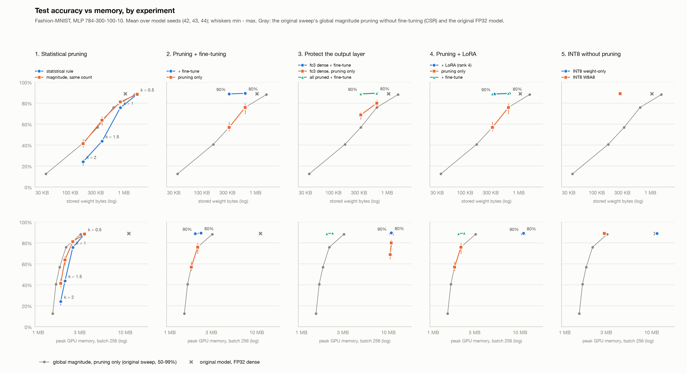
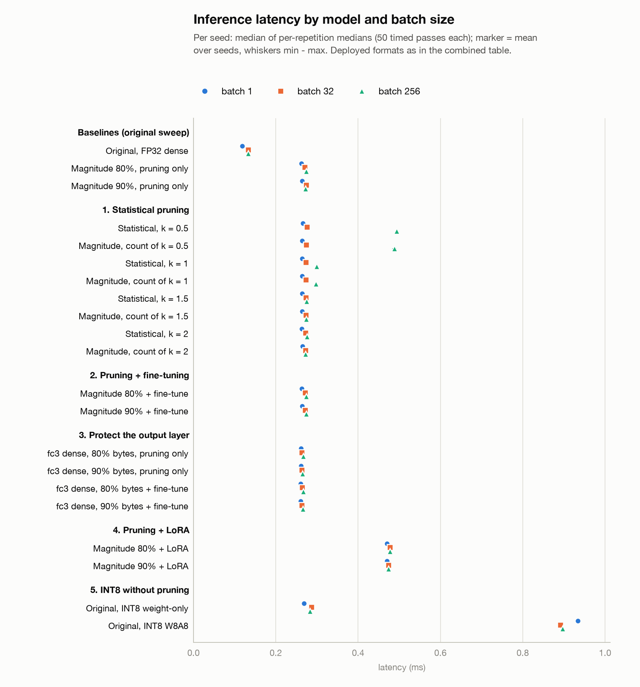
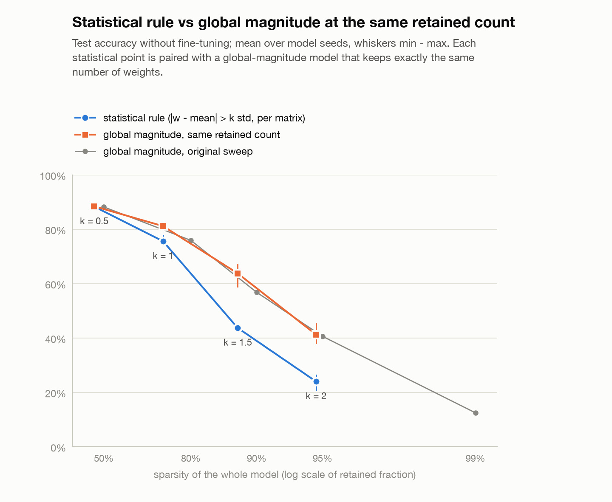

# MLP follow-up experiments: statistical pruning, recovery, protected output layer, LoRA, INT8

Results from `results/mlp_followup/cuda1`; baselines (original dense model, magnitude pruning without fine-tuning) from `results/mlp/cuda1`. Model seeds: 42, 43, 44. Values are means over model seeds, ranges in parentheses are min - max. Test accuracy is reported for the configuration selected on validation data. Every deployed format is checked against a dense implementation of the same modified model.

## Combined results

| Experiment | Model | Format | Sparsity | Test acc | vs original (pp) | Stored bytes | Resident b256 | Peak b1 | Peak b256 | Latency b1 (ms) | b32 | b256 | Matches reference |
|:---|---:|---:|---:|---:|---:|---:|---:|---:|---:|---:|---:|---:|---:|
| Baselines (original sweep) | Original, FP32 dense | FP32 dense | 0.0% | 88.99% (88.87% - 89.15%) | +0.00 | 1,064,800 | 1.9 MB | 9.6 MB | 11 MB | 0.1184 (0.1182 - 0.1186) | 0.1326 (0.1314 - 0.1333) | 0.1326 (0.1318 - 0.1333) | - |
| Baselines (original sweep) | Magnitude 80%, pruning only | CSR | 80.0% | 75.95% (69.79% - 79.54%) | -13.04 (-19.36 - -9.42) | 642,184 | 1.5 MB (1.4 MB - 1.5 MB) | 655 KB (654.3 KB - 655.4 KB) | 2.1 MB (2.1 MB - 2.1 MB) | 0.2625 (0.2618 - 0.2638) | 0.2699 (0.2694 - 0.2704) | 0.2743 (0.2736 - 0.2749) | yes |
| Baselines (original sweep) | Magnitude 90%, pruning only | CSR | 90.0% | 56.86% (53.55% - 61.92%) | -32.14 (-35.60 - -27.04) | 322,744 | 1.1 MB (1.1 MB - 1.1 MB) | 335.5 KB (334.8 KB - 335.9 KB) | 1.8 MB (1.8 MB - 1.8 MB) | 0.2638 (0.2631 - 0.2647) | 0.2738 (0.2736 - 0.2742) | 0.2722 (0.2708 - 0.2747) | yes |
| Statistical pruning | Statistical, k = 0.5 | CSR | 44.7% (44.2% - 45.0%) | 88.38% (88.08% - 88.77%) | -0.61 (-1.07 - -0.19) | 1,770,980 (1,761,700 - 1,785,688) | 2.6 MB (2.6 MB - 2.6 MB) | 1.8 MB (1.8 MB - 1.8 MB) | 3.4 MB (3.4 MB - 3.4 MB) | 0.2658 (0.2648 - 0.2672) | 0.2755 (0.2743 - 0.2769) | 0.4932 (0.4918 - 0.4948) | yes |
| Statistical pruning | Magnitude, count of k = 0.5 | CSR | 44.7% (44.2% - 45.0%) | 88.48% (88.29% - 88.71%) | -0.51 (-0.86 - -0.25) | 1,770,980 (1,761,700 - 1,785,688) | 2.6 MB (2.6 MB - 2.6 MB) | 1.8 MB (1.8 MB - 1.8 MB) | 3.4 MB (3.4 MB - 3.4 MB) | 0.2644 (0.2635 - 0.2654) | 0.2737 (0.2695 - 0.2764) | 0.4884 (0.4839 - 0.4923) | yes |
| Statistical pruning | Statistical, k = 1 | CSR | 73.2% (73.1% - 73.4%) | 75.64% (73.99% - 77.81%) | -13.36 (-15.16 - -11.15) | 859,136 (851,992 - 863,920) | 1.7 MB (1.7 MB - 1.7 MB) | 872.8 KB (865.3 KB - 877.6 KB) | 2.5 MB (2.5 MB - 2.5 MB) | 0.2638 (0.2628 - 0.2651) | 0.2734 (0.2728 - 0.2744) | 0.2990 (0.2965 - 0.3014) | yes |
| Statistical pruning | Magnitude, count of k = 1 | CSR | 73.2% (73.1% - 73.4%) | 81.19% (79.91% - 82.90%) | -7.80 (-9.24 - -6.06) | 859,136 (851,992 - 863,920) | 1.7 MB (1.7 MB - 1.7 MB) | 872.8 KB (865.3 KB - 877.1 KB) | 2.5 MB (2.5 MB - 2.5 MB) | 0.2636 (0.2616 - 0.2648) | 0.2727 (0.2713 - 0.2739) | 0.2971 (0.2952 - 0.2983) | yes |
| Statistical pruning | Statistical, k = 1.5 | CSR | 87.8% (87.7% - 88.0%) | 43.75% (43.40% - 44.08%) | -45.25 (-45.75 - -44.88) | 393,524 (387,484 - 397,552) | 1.2 MB (1.2 MB - 1.2 MB) | 406.9 KB (400.4 KB - 411.1 KB) | 2 MB (2 MB - 2 MB) | 0.2643 (0.2624 - 0.2657) | 0.2728 (0.2715 - 0.2746) | 0.2744 (0.2721 - 0.2763) | yes |
| Statistical pruning | Magnitude, count of k = 1.5 | CSR | 87.8% (87.7% - 88.0%) | 63.81% (58.92% - 66.97%) | -25.18 (-30.23 - -21.90) | 393,524 (387,484 - 397,552) | 1.2 MB (1.2 MB - 1.2 MB) | 407 KB (400.4 KB - 411.6 KB) | 2 MB (2 MB - 2 MB) | 0.2640 (0.2630 - 0.2646) | 0.2728 (0.2712 - 0.2758) | 0.2743 (0.2721 - 0.2764) | yes |
| Statistical pruning | Statistical, k = 2 | CSR | 94.6% (94.6% - 94.7%) | 24.04% (20.71% - 26.45%) | -64.95 (-68.16 - -62.51) | 174,272 (172,000 - 175,468) | 981.8 KB (980 KB - 983 KB) | 187.7 KB (185.9 KB - 188.9 KB) | 1.8 MB (1.8 MB - 1.8 MB) | 0.2632 (0.2617 - 0.2660) | 0.2717 (0.2705 - 0.2740) | 0.2760 (0.2753 - 0.2766) | yes |
| Statistical pruning | Magnitude, count of k = 2 | CSR | 94.6% (94.6% - 94.7%) | 41.29% (38.11% - 45.43%) | -47.70 (-50.76 - -43.53) | 174,272 (172,000 - 175,468) | 982.2 KB (979.5 KB - 983.6 KB) | 188.1 KB (185.3 KB - 189.4 KB) | 1.8 MB (1.8 MB - 1.8 MB) | 0.2653 (0.2648 - 0.2655) | 0.2718 (0.2706 - 0.2736) | 0.2723 (0.2718 - 0.2727) | yes |
| Pruning + fine-tuning | Magnitude 80% + fine-tune | CSR | 80.0% | 89.36% (89.24% - 89.48%) | +0.36 (+0.20 - +0.61) | 642,184 | 1.5 MB (1.4 MB - 1.5 MB) | 656 KB (655.4 KB - 656.4 KB) | 2.3 MB (2.3 MB - 2.3 MB) | 0.2628 (0.2616 - 0.2643) | 0.2709 (0.2703 - 0.2716) | 0.2744 (0.2734 - 0.2762) | yes |
| Pruning + fine-tuning | Magnitude 90% + fine-tune | CSR | 90.0% | 88.81% (88.73% - 88.86%) | -0.19 (-0.32 - -0.01) | 322,744 | 1.1 MB (1.1 MB - 1.1 MB) | 336.6 KB (335.9 KB - 336.9 KB) | 2 MB (2 MB - 2 MB) | 0.2643 (0.2626 - 0.2655) | 0.2710 (0.2703 - 0.2722) | 0.2738 (0.2726 - 0.2749) | yes |
| Protect the output layer | fc3 dense, 80% bytes, pruning only | CSR + dense fc3 | 79.7% | 79.93% (76.44% - 82.82%) | -9.06 (-12.43 - -6.14) | 642,184 | 1.4 MB (1.4 MB - 1.4 MB) | 9.2 MB (9.2 MB - 9.2 MB) | 10.8 MB (10.8 MB - 10.8 MB) | 0.2610 (0.2600 - 0.2625) | 0.2630 (0.2617 - 0.2638) | 0.2670 (0.2659 - 0.2678) | yes |
| Protect the output layer | fc3 dense, 90% bytes, pruning only | CSR + dense fc3 | 89.7% | 68.81% (64.61% - 71.21%) | -20.18 (-24.54 - -17.66) | 322,744 | 1.1 MB (1.1 MB - 1.1 MB) | 8.9 MB (8.9 MB - 8.9 MB) | 10.5 MB (10.5 MB - 10.5 MB) | 0.2610 (0.2597 - 0.2626) | 0.2627 (0.2621 - 0.2634) | 0.2645 (0.2640 - 0.2648) | yes |
| Protect the output layer | fc3 dense, 80% bytes + fine-tune | CSR + dense fc3 | 79.7% | 89.51% (89.32% - 89.70%) | +0.52 (+0.36 - +0.83) | 642,184 | 1.4 MB (1.4 MB - 1.4 MB) | 9.2 MB (9.2 MB - 9.2 MB) | 10.8 MB (10.8 MB - 10.8 MB) | 0.2605 (0.2601 - 0.2609) | 0.2639 (0.2631 - 0.2651) | 0.2664 (0.2652 - 0.2677) | yes |
| Protect the output layer | fc3 dense, 90% bytes + fine-tune | CSR + dense fc3 | 89.7% | 88.95% (88.80% - 89.06%) | -0.04 (-0.16 - +0.10) | 322,744 | 1.1 MB (1.1 MB - 1.1 MB) | 8.9 MB (8.9 MB - 8.9 MB) | 10.5 MB (10.5 MB - 10.5 MB) | 0.2607 (0.2587 - 0.2621) | 0.2634 (0.2624 - 0.2643) | 0.2655 (0.2648 - 0.2663) | yes |
| Pruning + LoRA | Magnitude 80% + LoRA | CSR + adapters | 80.0% | 89.21% (89.08% - 89.37%) | +0.22 (-0.07 - +0.50) | 667,688 | 1.5 MB (1.5 MB - 1.5 MB) | 9.2 MB (9.2 MB - 9.2 MB) | 10.9 MB (10.9 MB - 10.9 MB) | 0.4703 (0.4698 - 0.4707) | 0.4773 (0.4745 - 0.4798) | 0.4770 (0.4754 - 0.4788) | yes |
| Pruning + LoRA | Magnitude 90% + LoRA | CSR + adapters | 90.0% | 88.68% (88.21% - 88.96%) | -0.32 (-0.94 - +0.09) | 348,248 | 1.2 MB (1.2 MB - 1.2 MB) | 8.9 MB (8.9 MB - 8.9 MB) | 10.6 MB (10.6 MB - 10.6 MB) | 0.4705 (0.4698 - 0.4712) | 0.4740 (0.4735 - 0.4749) | 0.4736 (0.4723 - 0.4750) | yes |
| INT8 without pruning | Original, INT8 weight-only | INT8 weight-only | 0.0% | 88.99% (88.90% - 89.10%) | +0.00 (-0.05 - +0.03) | 267,840 | 1.1 MB | 10.7 MB | 11.5 MB | 0.2682 (0.2670 - 0.2699) | 0.2863 (0.2858 - 0.2871) | 0.2828 (0.2823 - 0.2832) | yes |
| INT8 without pruning | Original, INT8 W8A8 | INT8 W8A8 | 0.0% | 89.00% (88.88% - 89.10%) | +0.00 (-0.05 - +0.05) | 273,312 | 1.1 MB | 444.9 KB | 2.9 MB | 0.9336 (0.9305 - 0.9376) | 0.8913 (0.8893 - 0.8943) | 0.8970 (0.8962 - 0.8975) | yes |

Stored bytes: weight storage including indices, INT8 scales and LoRA adapters (biases, 1,640 B, excluded). Resident: torch.cuda.memory_allocated before the first pass (stored tensors, biases and the input batch). Peak: torch.cuda.max_memory_allocated over the timed passes; formats that run a dense matmul (FP32 dense, dense fc3, LoRA adapters, INT8) also hold the cuBLAS workspace. Latency: median of 50 synchronized passes after 20 warm-ups, median over repetitions, mean over seeds.

## 1. Statistical pruning vs matched global magnitude

The statistical rule scores higher than global magnitude with the same retained count at 0 of 4 thresholds (by the mean over seeds).

| k | Sparsity | Per-layer sparsity, statistical (fc1 / fc2 / fc3 %) | Per-layer, matched magnitude | Test acc, statistical | Test acc, matched magnitude | Difference (pp) | Stored bytes (both, CSR) |
|:---|---:|---:|---:|---:|---:|---:|---:|
| k = 0.5 | 44.66% (44.20% - 44.95%) | 45.0 / 42.5 / 34.8 | 45.5 / 39.1 / 24.0 | 88.38% (88.08% - 88.77%) | 88.48% (88.29% - 88.71%) | -0.10 (-0.21 - +0.06) | 1,770,980 (1,761,700 - 1,785,688) |
| k = 1 | 73.21% (73.06% - 73.43%) | 73.4 / 71.7 / 71.2 | 74.0 / 67.5 / 47.9 | 75.64% (73.99% - 77.81%) | 81.19% (79.91% - 82.90%) | -5.55 (-5.92 - -5.09) | 859,136 (851,992 - 863,920) |
| k = 1.5 | 87.78% (87.66% - 87.97%) | 87.8 / 87.4 / 89.4 | 88.3 / 84.1 / 67.2 | 43.75% (43.40% - 44.08%) | 63.81% (58.92% - 66.97%) | -20.07 (-23.21 - -15.52) | 393,524 (387,484 - 397,552) |
| k = 2 | 94.65% (94.61% - 94.72%) | 94.6 / 94.7 / 95.7 | 95.0 / 92.6 / 77.6 | 24.04% (20.71% - 26.45%) | 41.29% (38.11% - 45.43%) | -17.25 (-18.98 - -15.38) | 174,272 (172,000 - 175,468) |

Per matrix: keep w when |w - mean| > k * std (population std of that matrix's original weights, biases excluded). The matched baseline is global magnitude pruning that keeps exactly the same total number of weights, so both store the same CSR bytes. No fine-tuning.

## 2. Pruning + fine-tuning

| Sparsity | Pruning only (test) | Fine-tuned (test) | Fine-tuned (val) | Stored bytes | Selected on validation |
|:---|---:|---:|---:|---:|---:|
| 80% | 75.95% (69.79% - 79.54%) | 89.36% (89.24% - 89.48%) | 89.49% (89.26% - 89.76%) | 642,184 | m42: lr 0.001 ep 5, m43: lr 0.001 ep 4, m44: lr 0.001 ep 4 |
| 90% | 56.86% (53.55% - 61.92%) | 88.81% (88.73% - 88.86%) | 89.08% (88.86% - 89.50%) | 322,744 | m42: lr 0.001 ep 8, m43: lr 0.001 ep 7, m44: lr 0.001 ep 10 |

Masks fixed during fine-tuning (10 epochs per learning rate in [0.001, 0.0003, 0.0001]; Adam, batch 128); removed weights stay exactly zero, so the CSR bytes equal the pruning-only model's.

## 3. Protect the output layer

| Matched to | Target bytes (exp. 2) | Byte mismatch | Model sparsity | fc3 dense, pruning only | fc3 dense + fine-tune | All pruned + fine-tune (exp. 2) |
|:---|---:|---:|---:|---:|---:|---:|
| 80% | 642,184 | +0 | 79.75% | 79.93% (76.44% - 82.82%) | 89.51% (89.32% - 89.70%) | 89.36% (89.24% - 89.48%) |
| 90% | 322,744 | +0 | 89.75% | 68.81% (64.61% - 71.21%) | 88.95% (88.80% - 89.06%) | 88.81% (88.73% - 88.86%) |

fc3 stays dense and unpruned; fc1 and fc2 are pruned by global magnitude with the retained count chosen so the stored weight bytes (CSR fc1 + fc2, dense fc3) match experiment 2's all-CSR model. The same fine-tuning procedure as experiment 2.

## 4. Pruning + LoRA

| Sparsity | Pruning only (test) | LoRA (test) | Fine-tune (test) | Adapter bytes | Stored bytes (CSR + adapters) | Latency b1: LoRA vs pruning only (ms) | Latency b256 |
|:---|---:|---:|---:|---:|---:|---:|---:|
| 80% | 75.95% (69.79% - 79.54%) | 89.21% (89.08% - 89.37%) | 89.36% (89.24% - 89.48%) | 25,504 | 667,688 | 0.4703 vs 0.2625 | 0.4770 vs 0.2743 |
| 90% | 56.86% (53.55% - 61.92%) | 88.68% (88.21% - 88.96%) | 88.81% (88.73% - 88.86%) | 25,504 | 348,248 | 0.4705 vs 0.2638 | 0.4736 vs 0.2722 |

Rank-4 adapters (alpha 4) on fc1, fc2, fc3; pruned weights and biases frozen; same budget as experiment 2. At inference the adapters run as a separate low-rank product next to the CSR weights.

## 5. INT8 without pruning

| Format | Test acc | vs FP32 (pp) | Stored bytes | Latency b1 (ms) | b32 | b256 | Peak b1 | Peak b256 |
|:---|---:|---:|---:|---:|---:|---:|---:|---:|
| FP32 dense | 88.99% (88.87% - 89.15%) | +0.00 | 1,064,800 | 0.1184 (0.1182 - 0.1186) | 0.1326 (0.1314 - 0.1333) | 0.1326 (0.1318 - 0.1333) | 9.6 MB | 11 MB |
| INT8 weight-only | 88.99% (88.90% - 89.10%) | +0.00 (-0.05 - +0.03) | 267,840 | 0.2682 (0.2670 - 0.2699) | 0.2863 (0.2858 - 0.2871) | 0.2828 (0.2823 - 0.2832) | 10.7 MB | 11.5 MB |
| INT8 W8A8 | 89.00% (88.88% - 89.10%) | +0.00 (-0.05 - +0.05) | 273,312 | 0.9336 (0.9305 - 0.9376) | 0.8913 (0.8893 - 0.8943) | 0.8970 (0.8962 - 0.8975) | 444.9 KB | 2.9 MB |

INT8 matmul support check on `cuda:1`: `torch._int_mm` ran and matched an exact int64 product (smallest batch accepted: 17 rows; smaller batches are zero-padded).

Weight-only: int8 weights with one FP32 scale per output row, dequantized on the device each pass (FP32 compute). W8A8: activations quantized per sample at run time, int8 x int8 -> int32 matmul (torch._int_mm), weights zero-padded to multiples of 8. Stored bytes include the scales and padding.

## GPU memory by batch size

| Model | Format | Resident b1 | Peak b1 | Resident b32 | Peak b32 | Resident b256 | Peak b256 |
|:---|---:|---:|---:|---:|---:|---:|---:|
| Original, FP32 dense | FP32 dense | 1.1 MB | 9.6 MB | 1.2 MB | 9.8 MB | 1.9 MB | 11 MB |
| Magnitude 80%, pruning only | CSR | 650.9 KB (650.2 KB - 651.3 KB) | 655 KB (654.3 KB - 655.4 KB) | 747.7 KB (747 KB - 748 KB) | 841.4 KB (840.7 KB - 841.7 KB) | 1.5 MB (1.4 MB - 1.5 MB) | 2.1 MB (2.1 MB - 2.1 MB) |
| Magnitude 90%, pruning only | CSR | 331.4 KB (330.8 KB - 331.8 KB) | 335.5 KB (334.8 KB - 335.9 KB) | 428.2 KB (427.5 KB - 428.5 KB) | 514.2 KB (513.5 KB - 514.6 KB) | 1.1 MB (1.1 MB - 1.1 MB) | 1.8 MB (1.8 MB - 1.8 MB) |
| Statistical, k = 0.5 | CSR | 1.8 MB (1.8 MB - 1.8 MB) | 1.8 MB (1.8 MB - 1.8 MB) | 1.9 MB (1.9 MB - 1.9 MB) | 2 MB (2 MB - 2 MB) | 2.6 MB (2.6 MB - 2.6 MB) | 3.4 MB (3.4 MB - 3.4 MB) |
| Magnitude, count of k = 0.5 | CSR | 1.8 MB (1.8 MB - 1.8 MB) | 1.8 MB (1.8 MB - 1.8 MB) | 1.9 MB (1.9 MB - 1.9 MB) | 2 MB (2 MB - 2 MB) | 2.6 MB (2.6 MB - 2.6 MB) | 3.4 MB (3.4 MB - 3.4 MB) |
| Statistical, k = 1 | CSR | 867.7 KB (860.2 KB - 872.4 KB) | 872.8 KB (865.3 KB - 877.6 KB) | 964.4 KB (956.9 KB - 969.2 KB) | 1.1 MB (1.1 MB - 1.1 MB) | 1.7 MB (1.7 MB - 1.7 MB) | 2.5 MB (2.5 MB - 2.5 MB) |
| Magnitude, count of k = 1 | CSR | 867.7 KB (860.2 KB - 871.9 KB) | 872.8 KB (865.3 KB - 877.1 KB) | 964.4 KB (956.9 KB - 968.7 KB) | 1.1 MB (1.1 MB - 1.1 MB) | 1.7 MB (1.7 MB - 1.7 MB) | 2.5 MB (2.5 MB - 2.5 MB) |
| Statistical, k = 1.5 | CSR | 401.7 KB (395.3 KB - 406 KB) | 406.9 KB (400.4 KB - 411.1 KB) | 498.5 KB (492 KB - 502.8 KB) | 604 KB (597.5 KB - 608.3 KB) | 1.2 MB (1.2 MB - 1.2 MB) | 2 MB (2 MB - 2 MB) |
| Magnitude, count of k = 1.5 | CSR | 401.9 KB (395.3 KB - 406.5 KB) | 407 KB (400.4 KB - 411.6 KB) | 498.7 KB (492 KB - 503.3 KB) | 604.7 KB (598 KB - 609.3 KB) | 1.2 MB (1.2 MB - 1.2 MB) | 2 MB (2 MB - 2 MB) |
| Statistical, k = 2 | CSR | 182.6 KB (180.7 KB - 183.8 KB) | 187.7 KB (185.9 KB - 188.9 KB) | 279.4 KB (277.5 KB - 280.6 KB) | 384.3 KB (382.5 KB - 385.5 KB) | 981.8 KB (980 KB - 983 KB) | 1.8 MB (1.8 MB - 1.8 MB) |
| Magnitude, count of k = 2 | CSR | 183 KB (180.2 KB - 184.3 KB) | 188.1 KB (185.3 KB - 189.4 KB) | 279.7 KB (277 KB - 281.1 KB) | 384.7 KB (382 KB - 386 KB) | 982.2 KB (979.5 KB - 983.6 KB) | 1.8 MB (1.8 MB - 1.8 MB) |
| Magnitude 80% + fine-tune | CSR | 650.9 KB (650.2 KB - 651.3 KB) | 656 KB (655.4 KB - 656.4 KB) | 747.7 KB (747 KB - 748 KB) | 854.2 KB (853.5 KB - 854.5 KB) | 1.5 MB (1.4 MB - 1.5 MB) | 2.3 MB (2.3 MB - 2.3 MB) |
| Magnitude 90% + fine-tune | CSR | 331.4 KB (330.8 KB - 331.8 KB) | 336.6 KB (335.9 KB - 336.9 KB) | 428.2 KB (427.5 KB - 428.5 KB) | 533.7 KB (533 KB - 534 KB) | 1.1 MB (1.1 MB - 1.1 MB) | 2 MB (2 MB - 2 MB) |
| fc3 dense, 80% bytes, pruning only | CSR + dense fc3 | 650.1 KB (649.7 KB - 650.2 KB) | 9.2 MB (9.2 MB - 9.2 MB) | 746.8 KB (746.5 KB - 747 KB) | 9.4 MB (9.4 MB - 9.4 MB) | 1.4 MB (1.4 MB - 1.4 MB) | 10.8 MB (10.8 MB - 10.8 MB) |
| fc3 dense, 90% bytes, pruning only | CSR + dense fc3 | 330.4 KB (330.2 KB - 330.8 KB) | 8.9 MB (8.9 MB - 8.9 MB) | 427.2 KB (427 KB - 427.5 KB) | 9.1 MB (9.1 MB - 9.1 MB) | 1.1 MB (1.1 MB - 1.1 MB) | 10.5 MB (10.5 MB - 10.5 MB) |
| fc3 dense, 80% bytes + fine-tune | CSR + dense fc3 | 650.1 KB (649.7 KB - 650.2 KB) | 9.2 MB (9.2 MB - 9.2 MB) | 746.8 KB (746.5 KB - 747 KB) | 9.4 MB (9.4 MB - 9.4 MB) | 1.4 MB (1.4 MB - 1.4 MB) | 10.8 MB (10.8 MB - 10.8 MB) |
| fc3 dense, 90% bytes + fine-tune | CSR + dense fc3 | 330.4 KB (330.2 KB - 330.8 KB) | 8.9 MB (8.9 MB - 8.9 MB) | 427.2 KB (427 KB - 427.5 KB) | 9.1 MB (9.1 MB - 9.1 MB) | 1.1 MB (1.1 MB - 1.1 MB) | 10.5 MB (10.5 MB - 10.5 MB) |
| Magnitude 80% + LoRA | CSR + adapters | 678.6 KB (677.9 KB - 678.9 KB) | 9.2 MB (9.2 MB - 9.2 MB) | 775.3 KB (774.7 KB - 775.7 KB) | 9.4 MB (9.4 MB - 9.4 MB) | 1.5 MB (1.5 MB - 1.5 MB) | 10.9 MB (10.9 MB - 10.9 MB) |
| Magnitude 90% + LoRA | CSR + adapters | 359.1 KB (358.4 KB - 359.4 KB) | 8.9 MB (8.9 MB - 8.9 MB) | 455.9 KB (455.2 KB - 456.2 KB) | 9.1 MB (9.1 MB - 9.1 MB) | 1.2 MB (1.2 MB - 1.2 MB) | 10.6 MB (10.6 MB - 10.6 MB) |
| Original, INT8 weight-only | INT8 weight-only | 275.5 KB | 10.7 MB | 372.2 KB | 10.8 MB | 1.1 MB | 11.5 MB |
| Original, INT8 W8A8 | INT8 W8A8 | 281.1 KB | 444.9 KB | 377.9 KB | 601.1 KB | 1.1 MB | 2.9 MB |

## Equivalence with a dense implementation of the same modified model

| Model | Format | Max epsilon (eval) | Equivalent | Bitwise | Min agreement | Benchmark batches equivalent | Max epsilon (benchmark) |
|:---|---:|---:|---:|---:|---:|---:|---:|
| Magnitude 80%, pruning only | CSR | 1.1e-05 | yes | no | 100.00% | yes | 7.6e-06 |
| Magnitude 90%, pruning only | CSR | 7.6e-06 | yes | no | 100.00% | yes | 3.8e-06 |
| Statistical, k = 0.5 | CSR | 1.5e-05 | yes | no | 100.00% | yes | 1.1e-05 |
| Magnitude, count of k = 0.5 | CSR | 2.3e-05 | yes | no | 100.00% | yes | 1.5e-05 |
| Statistical, k = 1 | CSR | 1.1e-05 | yes | no | 100.00% | yes | 7.6e-06 |
| Magnitude, count of k = 1 | CSR | 1.5e-05 | yes | no | 100.00% | yes | 7.6e-06 |
| Statistical, k = 1.5 | CSR | 5.7e-06 | yes | no | 100.00% | yes | 5.7e-06 |
| Magnitude, count of k = 1.5 | CSR | 7.6e-06 | yes | no | 100.00% | yes | 3.8e-06 |
| Statistical, k = 2 | CSR | 2.4e-06 | yes | no | 100.00% | yes | 2.9e-06 |
| Magnitude, count of k = 2 | CSR | 3.8e-06 | yes | no | 100.00% | yes | 2.4e-06 |
| Magnitude 80% + fine-tune | CSR | 1.5e-05 | yes | no | 100.00% | yes | 1.1e-05 |
| Magnitude 90% + fine-tune | CSR | 1.5e-05 | yes | no | 100.00% | yes | 7.6e-06 |
| fc3 dense, 80% bytes, pruning only | CSR + dense fc3 | 9.5e-06 | yes | no | 100.00% | yes | 7.6e-06 |
| fc3 dense, 90% bytes, pruning only | CSR + dense fc3 | 5.7e-06 | yes | no | 100.00% | yes | 3.8e-06 |
| fc3 dense, 80% bytes + fine-tune | CSR + dense fc3 | 1.5e-05 | yes | no | 100.00% | yes | 1.5e-05 |
| fc3 dense, 90% bytes + fine-tune | CSR + dense fc3 | 1.1e-05 | yes | no | 100.00% | yes | 1.1e-05 |
| Magnitude 80% + LoRA | CSR + adapters | 1.9e-05 | yes | no | 100.00% | yes | 1.1e-05 |
| Magnitude 90% + LoRA | CSR + adapters | 1.1e-05 | yes | no | 100.00% | yes | 9.5e-06 |
| Original, INT8 weight-only | INT8 weight-only | 0.0e+00 | yes | yes | 100.00% | yes | 0.0e+00 |
| Original, INT8 W8A8 | INT8 W8A8 | 0.0e+00 | yes | yes | 100.00% | yes | 0.0e+00 |

Reference: pruned dense with adapters kept separate (CSR), FP32 dense with the dequantized int8 weights (INT8 weight-only), the same activation quantization with an exact integer matmul (INT8 W8A8). Evaluation over 5,000 validation + 10,000 test images; tolerance allclose(atol=1e-5, rtol=1e-4).

## Energy

Not measured: no reliable energy method has been established for the harness yet.
