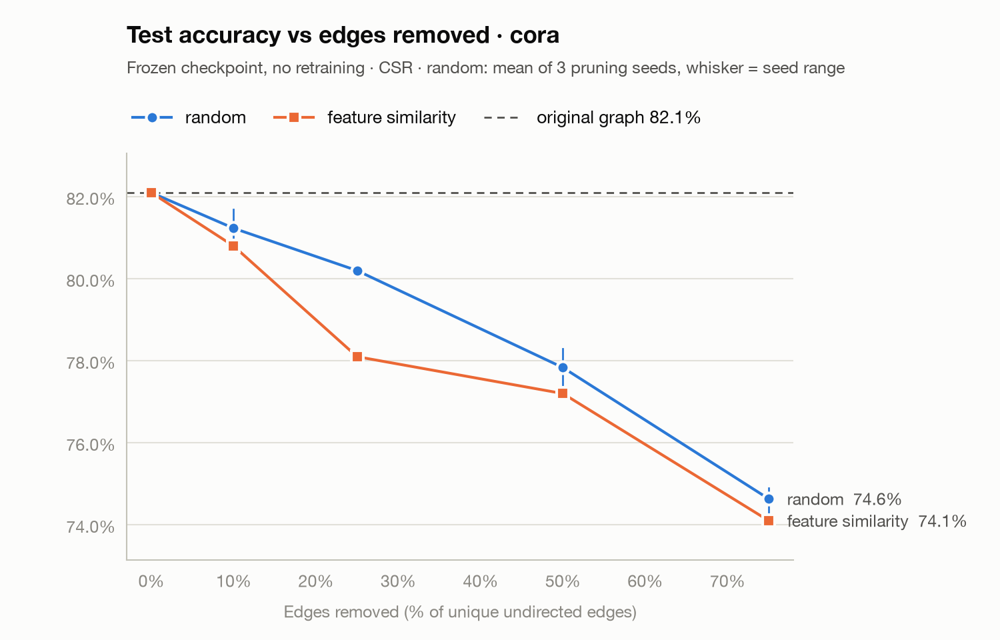
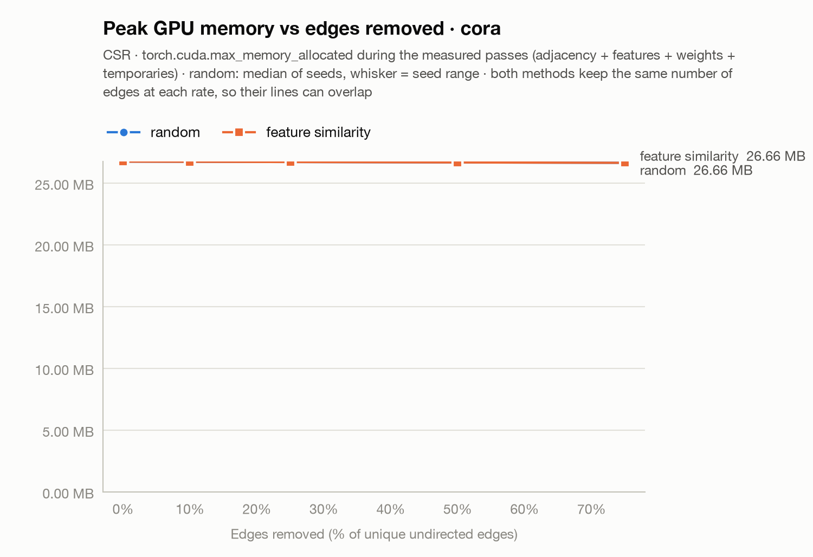
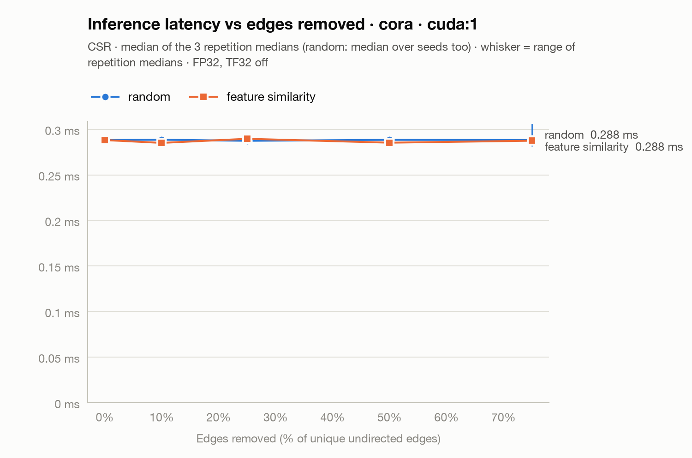
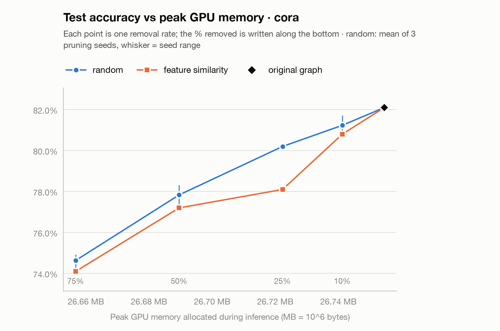
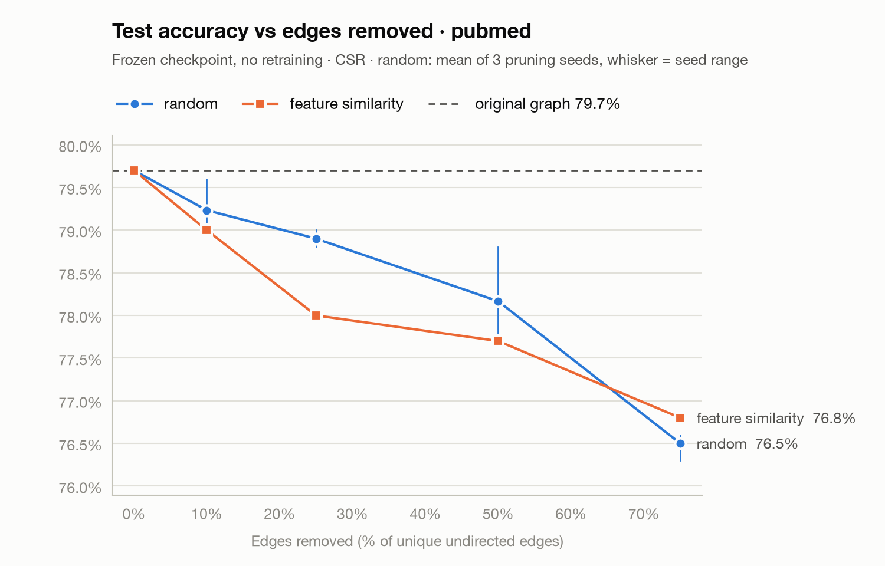
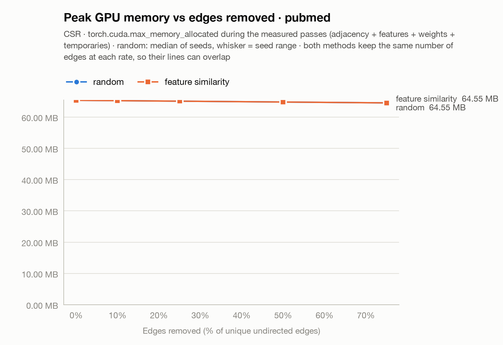
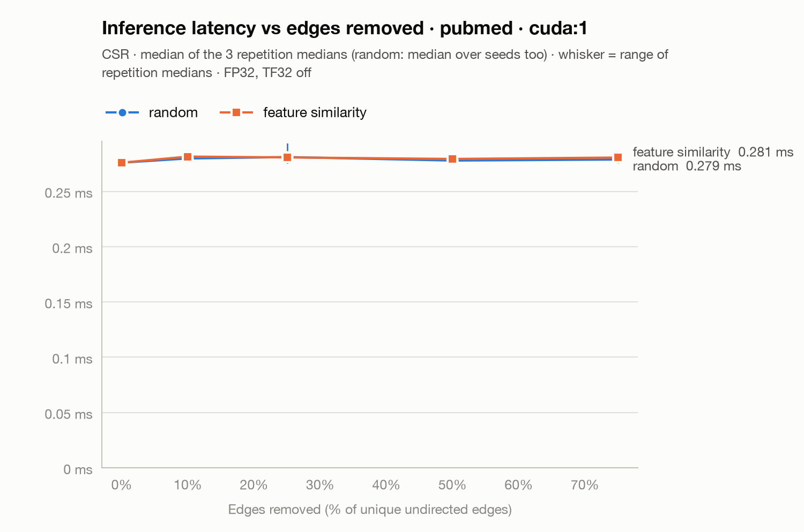
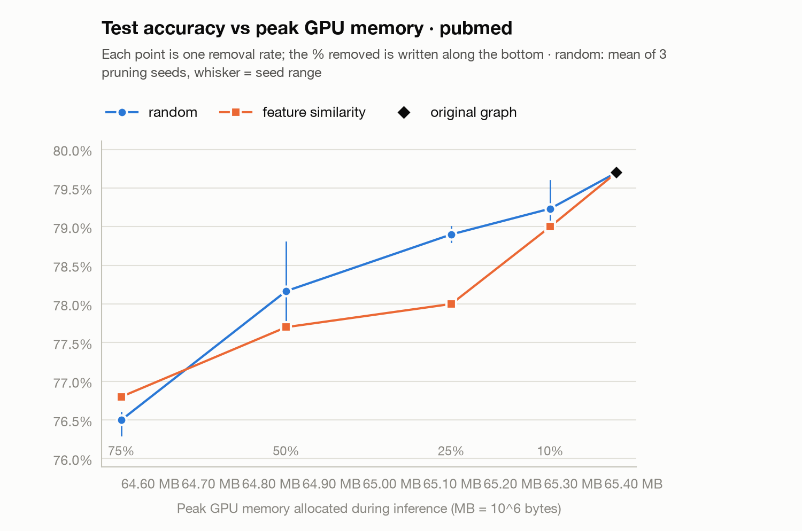

# Pruning and error-analysis results

Generated by `scripts/summarize_pruning_results.py`. One frozen checkpoint per dataset, no retraining. Pruning runs use CSR. Format error compares storage formats on the same graph; pruning effects compare a pruned graph with the original graph. Accuracy differences are in percentage points (pp); logit differences are raw logit units. Ranges are observed min–max spreads, not confidence intervals. Method and settings: `docs/pruning_and_error_analysis.md`.

## cora

Device cuda:1 (NVIDIA GeForce RTX 3090). Checkpoint `checkpoints/cora_seed42_gpu.pt` (sha256 347fe63a0d2c4e81, model seed 42, best epoch 45, val acc 81.0%). 51 pruning runs, none failed.

### 1. Unpruned format comparison (dense / COO / CSR)

| Format | Test acc | Acc diff (pp) | Agree (all) | Agree (test) | Mean \|Δlogit\| | ε_logit (max) | allclose | Adjacency | Peak alloc | Peak reserved | Latency ms [rep range] |
|:---|---:|---:|---:|---:|---:|---:|---:|---:|---:|---:|---:|
| dense | 82.1% | +0.00 | 100.00% | 100.00% | 2.2e-08 | 9.5e-07 | yes | 29.3 MB | 55.2 MB | 69.2 MB | 0.245 [0.245–0.245] |
| coo | 82.1% | +0.00 | 100.00% | 100.00% | 0.0e+00 | 0.0e+00 | yes | 265.3 KB | 27.6 MB | 41.9 MB | 0.458 [0.456–0.459] |
| csr | 82.1% | +0.00 | 100.00% | 100.00% | 3.0e-08 | 7.2e-07 | yes | 180.8 KB | 26.8 MB | 41.9 MB | 0.288 [0.288–0.289] |

Reference: COO on cuda:1. allclose(atol=1e-5, rtol=1e-4). Latency and peak memory from scripts/benchmark_gcn.py (peak counters reset before warm-up, as in the Cora baseline).

### 2. Pruning results (CSR)

| Method | Seed | Removed | Test acc | Loss test (pp) | Loss val (pp) | Disagree (all) | Disagree (test) | Adjacency | Peak alloc | Latency ms [rep range] |
|:---|---:|---:|---:|---:|---:|---:|---:|---:|---:|---:|
| original graph | - | 0.0% | 82.1% | +0.0 | +0.0 | 0.0% | 0.0% | 180.8 KB | 26.8 MB | 0.288 [0.288–0.290] |
| random | 101 | 10.0% | 80.8% | +1.3 | -0.2 | 2.4% | 2.9% | 168.2 KB | 26.7 MB | 0.289 [0.287–0.291] |
| random | 102 | 10.0% | 81.7% | +0.4 | +0.4 | 2.9% | 3.1% | 168.2 KB | 26.7 MB | 0.289 [0.284–0.289] |
| random | 103 | 10.0% | 81.2% | +0.9 | +0.4 | 3.0% | 2.9% | 168.2 KB | 26.7 MB | 0.288 [0.286–0.289] |
| random | 101 | 25.0% | 80.1% | +2.0 | +0.2 | 5.9% | 6.6% | 149.2 KB | 26.7 MB | 0.287 [0.286–0.288] |
| random | 102 | 25.0% | 80.2% | +1.9 | +1.8 | 6.0% | 6.4% | 149.2 KB | 26.7 MB | 0.288 [0.287–0.290] |
| random | 103 | 25.0% | 80.3% | +1.8 | +2.4 | 5.8% | 6.6% | 149.2 KB | 26.7 MB | 0.287 [0.286–0.288] |
| random | 101 | 50.0% | 78.1% | +4.0 | +3.4 | 10.0% | 10.3% | 117.5 KB | 26.7 MB | 0.287 [0.287–0.289] |
| random | 102 | 50.0% | 78.3% | +3.8 | +2.8 | 10.7% | 11.3% | 117.5 KB | 26.7 MB | 0.291 [0.288–0.292] |
| random | 103 | 50.0% | 77.1% | +5.0 | +6.4 | 10.3% | 10.7% | 117.5 KB | 26.7 MB | 0.289 [0.284–0.292] |
| random | 101 | 75.0% | 74.8% | +7.3 | +7.8 | 16.0% | 15.2% | 85.8 KB | 26.7 MB | 0.288 [0.288–0.290] |
| random | 102 | 75.0% | 74.9% | +7.2 | +7.8 | 15.8% | 16.1% | 85.8 KB | 26.7 MB | 0.290 [0.283–0.306] |
| random | 103 | 75.0% | 74.2% | +7.9 | +8.6 | 16.7% | 17.0% | 85.8 KB | 26.7 MB | 0.288 [0.282–0.288] |
| feature similarity | - | 10.0% | 80.8% | +1.3 | +2.2 | 3.9% | 2.9% | 168.2 KB | 26.7 MB | 0.285 [0.283–0.290] |
| feature similarity | - | 25.0% | 78.1% | +4.0 | +3.6 | 7.7% | 7.6% | 149.2 KB | 26.7 MB | 0.290 [0.289–0.291] |
| feature similarity | - | 50.0% | 77.2% | +4.9 | +7.0 | 13.1% | 12.9% | 117.5 KB | 26.7 MB | 0.285 [0.285–0.287] |
| feature similarity | - | 75.0% | 74.1% | +8.0 | +7.8 | 16.9% | 17.5% | 85.8 KB | 26.7 MB | 0.288 [0.287–0.292] |

Loss = original − pruned accuracy, in pp; negative means pruning improved accuracy. Disagreement is against the original graph's predictions with the same checkpoint.

### Random pruning across pruning seeds

| Removed | Seeds | Test acc mean [min–max] | Loss test pp mean [min–max] | Disagree test mean [min–max] |
|:---|---:|---:|---:|---:|
| 10.0% | 3 | 81.2% [80.8%–81.7%] | +0.9 [+0.4–+1.3] | 3.0% [2.9%–3.1%] |
| 25.0% | 3 | 80.2% [80.1%–80.3%] | +1.9 [+1.8–+2.0] | 6.5% [6.4%–6.6%] |
| 50.0% | 3 | 77.8% [77.1%–78.3%] | +4.3 [+3.8–+5.0] | 10.8% [10.3%–11.3%] |
| 75.0% | 3 | 74.6% [74.2%–74.9%] | +7.5 [+7.2–+7.9] | 16.1% [15.2%–17.0%] |

### 3. Accuracy vs edges removed

### 4. Peak memory vs edges removed

### 5. Inference latency vs edges removed

### 6. Accuracy vs peak memory

### Pruned graphs, preparation time and latency repetitions

| Condition | Removed / original edges | Retained | nnz (normalized) | Density | Isolated before self-loops | Order ms | Select+normalize+convert ms | Transfer ms | Rep medians (ms) |
|:---|---:|---:|---:|---:|---:|---:|---:|---:|---:|
| original graph | 0 / 5,278 | 5,278 | 13,264 | 0.1440% | 0 | 0.0 | 3.9 | 143.8 | 0.288, 0.288, 0.290 |
| random s101 10% | 527 / 5,278 | 4,751 | 12,210 | 0.1296% | 53 | 0.2 | 3.8 | 147.2 | 0.287, 0.289, 0.291 |
| random s102 10% | 527 / 5,278 | 4,751 | 12,210 | 0.1296% | 58 | 0.2 | 3.8 | 144.1 | 0.289, 0.289, 0.284 |
| random s103 10% | 527 / 5,278 | 4,751 | 12,210 | 0.1296% | 76 | 0.2 | 3.8 | 144.4 | 0.286, 0.288, 0.289 |
| random s101 25% | 1,319 / 5,278 | 3,959 | 10,626 | 0.1080% | 178 | 0.2 | 3.5 | 145.0 | 0.287, 0.288, 0.286 |
| random s102 25% | 1,319 / 5,278 | 3,959 | 10,626 | 0.1080% | 176 | 0.2 | 3.5 | 144.1 | 0.290, 0.288, 0.287 |
| random s103 25% | 1,319 / 5,278 | 3,959 | 10,626 | 0.1080% | 188 | 0.2 | 3.5 | 143.7 | 0.288, 0.287, 0.286 |
| random s101 50% | 2,639 / 5,278 | 2,639 | 7,986 | 0.0720% | 486 | 0.2 | 3.0 | 142.9 | 0.287, 0.287, 0.289 |
| random s102 50% | 2,639 / 5,278 | 2,639 | 7,986 | 0.0720% | 477 | 0.2 | 2.9 | 148.1 | 0.291, 0.292, 0.288 |
| random s103 50% | 2,639 / 5,278 | 2,639 | 7,986 | 0.0720% | 521 | 0.2 | 3.0 | 148.8 | 0.284, 0.292, 0.289 |
| random s101 75% | 3,958 / 5,278 | 1,320 | 5,348 | 0.0360% | 1,108 | 0.2 | 2.5 | 143.4 | 0.288, 0.290, 0.288 |
| random s102 75% | 3,958 / 5,278 | 1,320 | 5,348 | 0.0360% | 1,131 | 0.2 | 2.5 | 146.3 | 0.290, 0.306, 0.283 |
| random s103 75% | 3,958 / 5,278 | 1,320 | 5,348 | 0.0360% | 1,178 | 0.2 | 2.5 | 143.5 | 0.288, 0.282, 0.288 |
| feature similarity 10% | 527 / 5,278 | 4,751 | 12,210 | 0.1296% | 74 | 52.7 | 4.3 | 148.2 | 0.290, 0.283, 0.285 |
| feature similarity 25% | 1,319 / 5,278 | 3,959 | 10,626 | 0.1080% | 175 | 53.9 | 3.9 | 146.2 | 0.291, 0.289, 0.290 |
| feature similarity 50% | 2,639 / 5,278 | 2,639 | 7,986 | 0.0720% | 527 | 52.7 | 3.1 | 147.5 | 0.285, 0.287, 0.285 |
| feature similarity 75% | 3,958 / 5,278 | 1,320 | 5,348 | 0.0360% | 1,202 | 54.7 | 2.5 | 140.7 | 0.288, 0.287, 0.292 |

Order ms = scoring/ordering the edges (0 for the original graph). None of these are included in inference latency.

### 7a. Format error: same graph, different format (reference COO on the same device)

| Graph | Format vs COO | Mean \|Δlogit\| | ε_logit | allclose | Acc diff test (pp) | \|Acc diff\| (pp) | Disagree all / test | margin > 2ε all / test | Disagreements with margin > 2ε |
|:---|---:|---:|---:|---:|---:|---:|---:|---:|---:|
| original graph | dense | 2.2e-08 | 4.8e-07 | yes | +0.00 | 0.00 | 0.00% / 0.00% | 100.0% / 100.0% | 0 |
| original graph | csr | 3.0e-08 | 7.2e-07 | yes | +0.00 | 0.00 | 0.00% / 0.00% | 100.0% / 100.0% | 0 |
| random s101 50% | dense | 1.3e-08 | 4.8e-07 | yes | +0.00 | 0.00 | 0.00% / 0.00% | 100.0% / 100.0% | 0 |
| random s101 50% | csr | 2.4e-08 | 7.2e-07 | yes | +0.00 | 0.00 | 0.00% / 0.00% | 100.0% / 100.0% | 0 |
| feature similarity 50% | dense | 1.4e-08 | 4.8e-07 | yes | +0.00 | 0.00 | 0.00% / 0.00% | 100.0% / 100.0% | 0 |
| feature similarity 50% | csr | 2.4e-08 | 4.8e-07 | yes | +0.00 | 0.00 | 0.00% / 0.00% | 100.0% / 100.0% | 0 |

All formats equivalent on every verified graph: yes.

### 7b. Pruning effects: pruned vs original graph (CSR, same checkpoint)

| Pruned graph vs original (CSR) | Mean \|Δlogit\| | ε_logit | Loss test (pp) | Disagree all / test | margin > 2ε all / test | Disagreements with margin > 2ε | \|loss\| ≤ disagreement |
|:---|---:|---:|---:|---:|---:|---:|---:|
| random s101 10% | 0.053 | 4.064 | +1.3 | 2.4% / 2.9% | 88.5% / 87.6% | 0 | yes |
| random s102 10% | 0.055 | 3.283 | +0.4 | 2.9% / 3.1% | 87.2% / 86.4% | 0 | yes |
| random s103 10% | 0.057 | 4.049 | +0.9 | 3.0% / 2.9% | 87.3% / 86.2% | 0 | yes |
| random s101 25% | 0.114 | 4.064 | +2.0 | 5.9% / 6.6% | 74.8% / 72.1% | 0 | yes |
| random s102 25% | 0.113 | 3.283 | +1.9 | 6.0% / 6.4% | 74.4% / 73.8% | 0 | yes |
| random s103 25% | 0.115 | 4.049 | +1.8 | 5.8% / 6.6% | 75.0% / 71.8% | 0 | yes |
| random s101 50% | 0.203 | 4.064 | +4.0 | 10.0% / 10.3% | 57.8% / 54.7% | 0 | yes |
| random s102 50% | 0.203 | 3.283 | +3.8 | 10.7% / 11.3% | 58.4% / 56.4% | 0 | yes |
| random s103 50% | 0.209 | 4.049 | +5.0 | 10.3% / 10.7% | 57.3% / 53.9% | 0 | yes |
| random s101 75% | 0.310 | 4.064 | +7.3 | 16.0% / 15.2% | 40.0% / 36.7% | 0 | yes |
| random s102 75% | 0.317 | 4.064 | +7.2 | 15.8% / 16.1% | 38.8% / 36.5% | 0 | yes |
| random s103 75% | 0.313 | 4.049 | +7.9 | 16.7% / 17.0% | 39.1% / 35.3% | 0 | yes |
| feature similarity 10% | 0.067 | 4.049 | +1.3 | 3.9% / 2.9% | 85.9% / 85.7% | 0 | yes |
| feature similarity 25% | 0.133 | 4.049 | +4.0 | 7.7% / 7.6% | 72.0% / 67.6% | 0 | yes |
| feature similarity 50% | 0.234 | 4.049 | +4.9 | 13.1% / 12.9% | 52.7% / 49.4% | 0 | yes |
| feature similarity 75% | 0.338 | 4.886 | +8.0 | 16.9% / 17.5% | 36.0% / 33.1% | 0 | yes |

margin > 2ε is sufficient for an unchanged prediction, so the 'Disagreements with margin > 2ε' column must be 0. Recomputed in float64 from the saved logits.

### Checks

- every pruning run matches COO on CPU for its own graph: yes
- accuracy and disagreement identical across repetitions: yes
- same checkpoint in every run: yes
- logits bit-identical across repetitions in 8 of 17 conditions (sparse GPU kernels are not bit-reproducible between processes)
- original-graph logits recomputed in every run: max difference between processes 2.4e-07, identical predictions: yes

## pubmed

Device cuda:1 (NVIDIA GeForce RTX 3090). Checkpoint `checkpoints/pubmed_seed42_gpu.pt` (sha256 05dae13dd0ffa1bb, model seed 42, best epoch 59, val acc 80.8%). 51 pruning runs, none failed.

### 1. Unpruned format comparison (dense / COO / CSR)

| Format | Test acc | Acc diff (pp) | Agree (all) | Agree (test) | Mean \|Δlogit\| | ε_logit (max) | allclose | Adjacency | Peak alloc | Peak reserved | Latency ms [rep range] |
|:---|---:|---:|---:|---:|---:|---:|---:|---:|---:|---:|---:|
| dense | 79.7% | +0.00 | 100.00% | 100.00% | 2.9e-08 | 4.8e-07 | yes | 1.6 GB | 1.6 GB | 1.6 GB | 4.987 [4.985–5.010] |
| coo | 79.7% | +0.00 | 100.00% | 100.00% | 0.0e+00 | 0.0e+00 | yes | 2.2 MB | 72.2 MB | 86.0 MB | 0.451 [0.450–0.455] |
| csr | 79.7% | +0.00 | 100.00% | 100.00% | 3.5e-08 | 9.5e-07 | yes | 1.5 MB | 65.4 MB | 86.0 MB | 0.281 [0.278–0.284] |

Reference: COO on cuda:1. allclose(atol=1e-5, rtol=1e-4). Latency and peak memory from scripts/benchmark_gcn.py (peak counters reset before warm-up, as in the Cora baseline).

### 2. Pruning results (CSR)

| Method | Seed | Removed | Test acc | Loss test (pp) | Loss val (pp) | Disagree (all) | Disagree (test) | Adjacency | Peak alloc | Latency ms [rep range] |
|:---|---:|---:|---:|---:|---:|---:|---:|---:|---:|---:|
| original graph | - | 0.0% | 79.7% | +0.0 | +0.0 | 0.0% | 0.0% | 1.5 MB | 65.4 MB | 0.276 [0.275–0.279] |
| random | 101 | 10.0% | 79.0% | +0.7 | +1.0 | 2.5% | 1.8% | 1.4 MB | 65.3 MB | 0.280 [0.279–0.280] |
| random | 102 | 10.0% | 79.6% | +0.1 | +0.2 | 2.5% | 1.9% | 1.4 MB | 65.3 MB | 0.281 [0.278–0.282] |
| random | 103 | 10.0% | 79.1% | +0.6 | +0.8 | 2.3% | 1.8% | 1.4 MB | 65.3 MB | 0.280 [0.280–0.280] |
| random | 101 | 25.0% | 78.8% | +0.9 | +1.8 | 4.9% | 4.6% | 1.2 MB | 65.1 MB | 0.281 [0.278–0.281] |
| random | 102 | 25.0% | 79.0% | +0.7 | -0.2 | 5.2% | 3.4% | 1.2 MB | 65.1 MB | 0.282 [0.276–0.293] |
| random | 103 | 25.0% | 78.9% | +0.8 | +1.6 | 4.7% | 3.9% | 1.2 MB | 65.1 MB | 0.280 [0.277–0.281] |
| random | 101 | 50.0% | 78.0% | +1.7 | +2.4 | 8.7% | 8.5% | 926.2 KB | 64.8 MB | 0.280 [0.276–0.280] |
| random | 102 | 50.0% | 78.8% | +0.9 | +1.8 | 8.8% | 7.3% | 926.2 KB | 64.8 MB | 0.278 [0.277–0.279] |
| random | 103 | 50.0% | 77.7% | +2.0 | +3.2 | 8.8% | 9.5% | 926.2 KB | 64.8 MB | 0.278 [0.278–0.282] |
| random | 101 | 75.0% | 76.3% | +3.4 | +3.4 | 12.3% | 11.9% | 660.3 KB | 64.6 MB | 0.277 [0.276–0.280] |
| random | 102 | 75.0% | 76.6% | +3.1 | +3.6 | 12.4% | 11.8% | 660.3 KB | 64.6 MB | 0.279 [0.275–0.281] |
| random | 103 | 75.0% | 76.6% | +3.1 | +3.8 | 12.5% | 13.0% | 660.3 KB | 64.6 MB | 0.280 [0.278–0.284] |
| feature similarity | - | 10.0% | 79.0% | +0.7 | +2.6 | 3.6% | 3.0% | 1.4 MB | 65.3 MB | 0.281 [0.279–0.283] |
| feature similarity | - | 25.0% | 78.0% | +1.7 | +3.2 | 6.7% | 6.1% | 1.2 MB | 65.1 MB | 0.281 [0.280–0.282] |
| feature similarity | - | 50.0% | 77.7% | +2.0 | +3.6 | 11.0% | 10.3% | 926.2 KB | 64.8 MB | 0.279 [0.276–0.281] |
| feature similarity | - | 75.0% | 76.8% | +2.9 | +6.2 | 14.3% | 13.6% | 660.3 KB | 64.6 MB | 0.281 [0.277–0.285] |

Loss = original − pruned accuracy, in pp; negative means pruning improved accuracy. Disagreement is against the original graph's predictions with the same checkpoint.

### Random pruning across pruning seeds

| Removed | Seeds | Test acc mean [min–max] | Loss test pp mean [min–max] | Disagree test mean [min–max] |
|:---|---:|---:|---:|---:|
| 10.0% | 3 | 79.2% [79.0%–79.6%] | +0.5 [+0.1–+0.7] | 1.8% [1.8%–1.9%] |
| 25.0% | 3 | 78.9% [78.8%–79.0%] | +0.8 [+0.7–+0.9] | 4.0% [3.4%–4.6%] |
| 50.0% | 3 | 78.2% [77.7%–78.8%] | +1.5 [+0.9–+2.0] | 8.4% [7.3%–9.5%] |
| 75.0% | 3 | 76.5% [76.3%–76.6%] | +3.2 [+3.1–+3.4] | 12.2% [11.8%–13.0%] |

### 3. Accuracy vs edges removed

### 4. Peak memory vs edges removed

### 5. Inference latency vs edges removed

### 6. Accuracy vs peak memory

### Pruned graphs, preparation time and latency repetitions

| Condition | Removed / original edges | Retained | nnz (normalized) | Density | Isolated before self-loops | Order ms | Select+normalize+convert ms | Transfer ms | Rep medians (ms) |
|:---|---:|---:|---:|---:|---:|---:|---:|---:|---:|
| original graph | 0 / 44,324 | 44,324 | 108,365 | 0.0228% | 0 | 0.0 | 17.3 | 150.9 | 0.279, 0.276, 0.275 |
| random s101 10% | 4,432 / 44,324 | 39,892 | 99,501 | 0.0205% | 936 | 1.2 | 16.0 | 149.7 | 0.280, 0.280, 0.279 |
| random s102 10% | 4,432 / 44,324 | 39,892 | 99,501 | 0.0205% | 917 | 1.2 | 15.9 | 151.9 | 0.282, 0.278, 0.281 |
| random s103 10% | 4,432 / 44,324 | 39,892 | 99,501 | 0.0205% | 919 | 1.2 | 15.7 | 155.7 | 0.280, 0.280, 0.280 |
| random s101 25% | 11,081 / 44,324 | 33,243 | 86,203 | 0.0171% | 2,532 | 1.2 | 14.8 | 151.9 | 0.281, 0.278, 0.281 |
| random s102 25% | 11,081 / 44,324 | 33,243 | 86,203 | 0.0171% | 2,465 | 1.2 | 14.7 | 151.9 | 0.282, 0.293, 0.276 |
| random s103 25% | 11,081 / 44,324 | 33,243 | 86,203 | 0.0171% | 2,499 | 1.2 | 14.5 | 152.3 | 0.281, 0.280, 0.277 |
| random s101 50% | 22,162 / 44,324 | 22,162 | 64,041 | 0.0114% | 5,753 | 1.2 | 12.0 | 153.4 | 0.276, 0.280, 0.280 |
| random s102 50% | 22,162 / 44,324 | 22,162 | 64,041 | 0.0114% | 5,627 | 1.2 | 11.8 | 153.5 | 0.279, 0.278, 0.277 |
| random s103 50% | 22,162 / 44,324 | 22,162 | 64,041 | 0.0114% | 5,705 | 1.2 | 11.9 | 153.3 | 0.278, 0.278, 0.282 |
| random s101 75% | 33,243 / 44,324 | 11,081 | 41,879 | 0.0057% | 10,129 | 1.2 | 8.3 | 154.6 | 0.280, 0.277, 0.276 |
| random s102 75% | 33,243 / 44,324 | 11,081 | 41,879 | 0.0057% | 10,020 | 1.2 | 8.2 | 159.4 | 0.275, 0.281, 0.279 |
| random s103 75% | 33,243 / 44,324 | 11,081 | 41,879 | 0.0057% | 10,026 | 1.2 | 8.1 | 154.9 | 0.284, 0.280, 0.278 |
| feature similarity 10% | 4,432 / 44,324 | 39,892 | 99,501 | 0.0205% | 1,079 | 177.5 | 16.8 | 149.8 | 0.279, 0.281, 0.283 |
| feature similarity 25% | 11,081 / 44,324 | 33,243 | 86,203 | 0.0171% | 2,921 | 176.8 | 15.4 | 150.7 | 0.282, 0.281, 0.280 |
| feature similarity 50% | 22,162 / 44,324 | 22,162 | 64,041 | 0.0114% | 6,632 | 176.4 | 13.3 | 150.9 | 0.281, 0.279, 0.276 |
| feature similarity 75% | 33,243 / 44,324 | 11,081 | 41,879 | 0.0057% | 11,404 | 177.6 | 10.0 | 152.1 | 0.281, 0.277, 0.285 |

Order ms = scoring/ordering the edges (0 for the original graph). None of these are included in inference latency.

### 7a. Format error: same graph, different format (reference COO on the same device)

| Graph | Format vs COO | Mean \|Δlogit\| | ε_logit | allclose | Acc diff test (pp) | \|Acc diff\| (pp) | Disagree all / test | margin > 2ε all / test | Disagreements with margin > 2ε |
|:---|---:|---:|---:|---:|---:|---:|---:|---:|---:|
| original graph | dense | 2.9e-08 | 4.8e-07 | yes | +0.00 | 0.00 | 0.00% / 0.00% | 100.0% / 100.0% | 0 |
| original graph | csr | 3.5e-08 | 9.5e-07 | yes | +0.00 | 0.00 | 0.00% / 0.00% | 100.0% / 100.0% | 0 |
| random s101 50% | dense | 2.1e-08 | 9.5e-07 | yes | +0.00 | 0.00 | 0.00% / 0.00% | 100.0% / 100.0% | 0 |
| random s101 50% | csr | 2.6e-08 | 9.5e-07 | yes | +0.00 | 0.00 | 0.00% / 0.00% | 100.0% / 100.0% | 0 |
| feature similarity 50% | dense | 2.0e-08 | 9.5e-07 | yes | +0.00 | 0.00 | 0.00% / 0.00% | 100.0% / 100.0% | 0 |
| feature similarity 50% | csr | 2.5e-08 | 9.5e-07 | yes | +0.00 | 0.00 | 0.00% / 0.00% | 100.0% / 100.0% | 0 |

All formats equivalent on every verified graph: yes.

### 7b. Pruning effects: pruned vs original graph (CSR, same checkpoint)

| Pruned graph vs original (CSR) | Mean \|Δlogit\| | ε_logit | Loss test (pp) | Disagree all / test | margin > 2ε all / test | Disagreements with margin > 2ε | \|loss\| ≤ disagreement |
|:---|---:|---:|---:|---:|---:|---:|---:|
| random s101 10% | 0.072 | 2.850 | +0.7 | 2.5% / 1.8% | 90.6% / 92.2% | 0 | yes |
| random s102 10% | 0.073 | 2.960 | +0.1 | 2.5% / 1.9% | 90.7% / 90.4% | 0 | yes |
| random s103 10% | 0.074 | 3.705 | +0.6 | 2.3% / 1.8% | 90.7% / 91.5% | 0 | yes |
| random s101 25% | 0.160 | 3.728 | +0.9 | 4.9% / 4.6% | 79.4% / 80.2% | 0 | yes |
| random s102 25% | 0.159 | 3.779 | +0.7 | 5.2% / 3.4% | 79.8% / 82.5% | 0 | yes |
| random s103 25% | 0.160 | 3.705 | +0.8 | 4.7% / 3.9% | 79.8% / 81.1% | 0 | yes |
| random s101 50% | 0.304 | 3.728 | +1.7 | 8.7% / 8.5% | 62.0% / 62.0% | 0 | yes |
| random s102 50% | 0.300 | 3.779 | +0.9 | 8.8% / 7.3% | 62.8% / 64.0% | 0 | yes |
| random s103 50% | 0.305 | 3.929 | +2.0 | 8.8% / 9.5% | 62.1% / 62.3% | 0 | yes |
| random s101 75% | 0.458 | 3.728 | +3.4 | 12.3% / 11.9% | 44.1% / 43.4% | 0 | yes |
| random s102 75% | 0.457 | 3.785 | +3.1 | 12.4% / 11.8% | 44.3% / 42.7% | 0 | yes |
| random s103 75% | 0.459 | 3.929 | +3.1 | 12.5% / 13.0% | 43.6% / 43.7% | 0 | yes |
| feature similarity 10% | 0.098 | 3.929 | +0.7 | 3.6% / 3.0% | 87.9% / 88.7% | 0 | yes |
| feature similarity 25% | 0.206 | 3.929 | +1.7 | 6.7% / 6.1% | 74.9% / 73.8% | 0 | yes |
| feature similarity 50% | 0.364 | 3.929 | +2.0 | 11.0% / 10.3% | 55.8% / 56.4% | 0 | yes |
| feature similarity 75% | 0.502 | 3.955 | +2.9 | 14.3% / 13.6% | 39.7% / 40.6% | 0 | yes |

margin > 2ε is sufficient for an unchanged prediction, so the 'Disagreements with margin > 2ε' column must be 0. Recomputed in float64 from the saved logits.

### Checks

- every pruning run matches COO on CPU for its own graph: yes
- accuracy and disagreement identical across repetitions: yes
- same checkpoint in every run: yes
- logits bit-identical across repetitions in 4 of 17 conditions (sparse GPU kernels are not bit-reproducible between processes)
- original-graph logits recomputed in every run: max difference between processes 4.8e-07, identical predictions: yes
