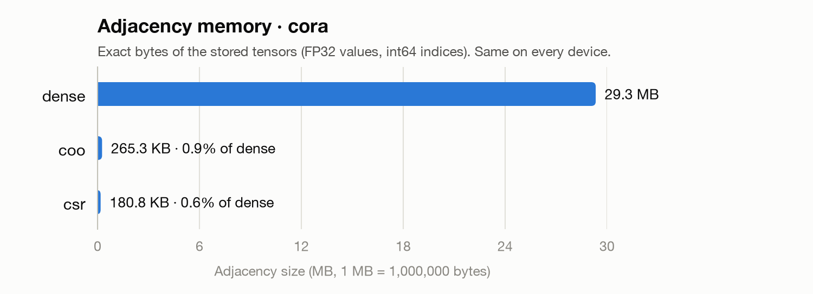
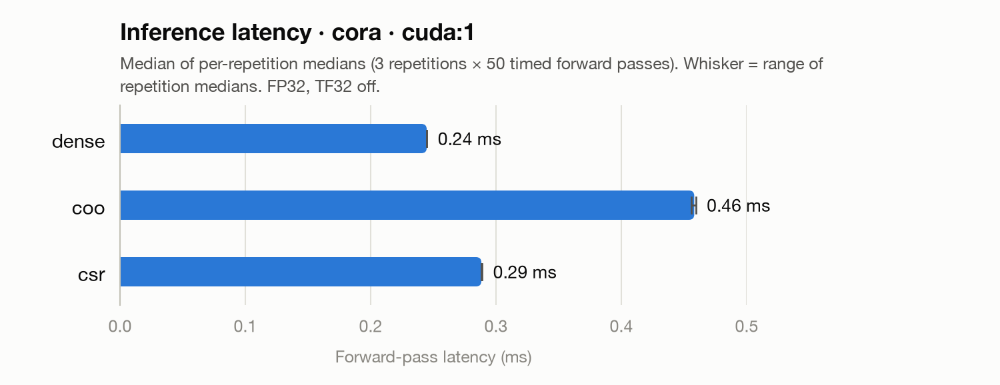
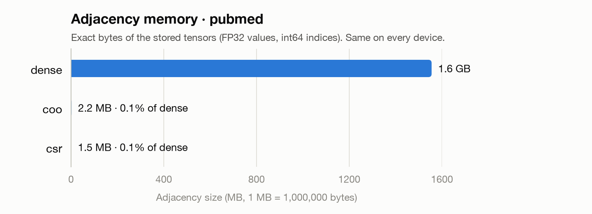
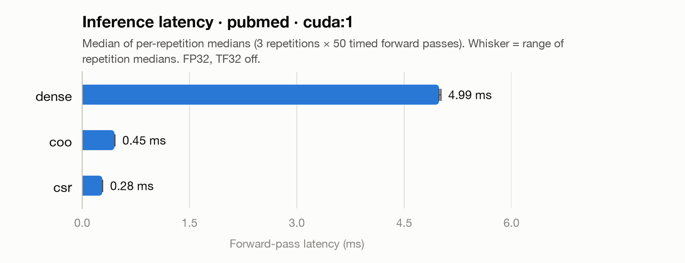

# GCN results summary

Generated by `scripts/summarize_gcn_results.py` from `results/gpu`. Latency measured on CPU (or any non-CUDA device) is for debugging only and is not a GPU result.

## cora

### Training (checkpoint)

| Best epoch | Val acc | Test acc | Seed | Hidden | Dropout | Trained with |
|:---|---:|---:|---:|---:|---:|---:|
| 45 | 81.00% | 82.10% | 42 | 64 | 0.5 | COO |

### Prediction equivalence · cuda:1

| Format | Test acc | Acc diff (pp) | Agree (all) | Agree (test) | Mean \|Δlogit\| | Max \|Δlogit\| | allclose | Equivalent |
|:---|---:|---:|---:|---:|---:|---:|---:|---:|
| dense | 82.10% | +0.00 | 100.00% | 100.00% | 2.2e-08 | 9.5e-07 | yes | yes |
| coo | 82.10% | +0.00 | 100.00% | 100.00% | 0.0e+00 | 0.0e+00 | yes | yes |
| csr | 82.10% | +0.00 | 100.00% | 100.00% | 3.0e-08 | 7.2e-07 | yes | yes |

All formats equivalent: yes (reference: COO; allclose atol=1e-5, rtol=1e-4)

### Adjacency memory

| Format | Bytes | Size | % of dense | Components (bytes) |
|:---|---:|---:|---:|---:|
| dense | 29,333,056 | 29.3 MB | 100.00% | values 29,333,056 |
| coo | 265,280 | 265.3 KB | 0.90% | values 53,056 + indices 212,224 |
| csr | 180,840 | 180.8 KB | 0.62% | values 53,056 + col_indices 106,112 + crow_indices 21,672 |

### Inference latency · cuda:1

| Format | Reps | Median (ms) | Mean (ms) | Std (ms) | Min (ms) | Max (ms) | Peak CUDA alloc | Peak CUDA reserved | Matches COO |
|:---|---:|---:|---:|---:|---:|---:|---:|---:|---:|
| dense | 3 | 0.245 | 0.246 | 0.003 | 0.243 | 0.256 | 55.2 MB | 69.2 MB | yes |
| coo | 3 | 0.458 | 0.459 | 0.007 | 0.448 | 0.486 | 27.6 MB | 41.9 MB | yes |
| csr | 3 | 0.288 | 0.291 | 0.006 | 0.283 | 0.308 | 26.8 MB | 41.9 MB | yes |

## pubmed

### Prediction equivalence · cuda:1

| Format | Test acc | Acc diff (pp) | Agree (all) | Agree (test) | Mean \|Δlogit\| | Max \|Δlogit\| | allclose | Equivalent |
|:---|---:|---:|---:|---:|---:|---:|---:|---:|
| dense | 79.70% | +0.00 | 100.00% | 100.00% | 2.9e-08 | 4.8e-07 | yes | yes |
| coo | 79.70% | +0.00 | 100.00% | 100.00% | 0.0e+00 | 0.0e+00 | yes | yes |
| csr | 79.70% | +0.00 | 100.00% | 100.00% | 3.5e-08 | 9.5e-07 | yes | yes |

All formats equivalent: yes (reference: COO; allclose atol=1e-5, rtol=1e-4)

### Adjacency memory

| Format | Bytes | Size | % of dense | Components (bytes) |
|:---|---:|---:|---:|---:|
| dense | 1,555,040,356 | 1.6 GB | 100.00% | values 1,555,040,356 |
| coo | 2,167,300 | 2.2 MB | 0.14% | values 433,460 + indices 1,733,840 |
| csr | 1,458,124 | 1.5 MB | 0.09% | values 433,460 + col_indices 866,920 + crow_indices 157,744 |

### Inference latency · cuda:1

| Format | Reps | Median (ms) | Mean (ms) | Std (ms) | Min (ms) | Max (ms) | Peak CUDA alloc | Peak CUDA reserved | Matches COO |
|:---|---:|---:|---:|---:|---:|---:|---:|---:|---:|
| dense | 3 | 4.987 | 4.994 | 0.012 | 4.977 | 5.019 | 1.6 GB | 1.6 GB | yes |
| coo | 3 | 0.451 | 0.460 | 0.047 | 0.441 | 0.810 | 72.2 MB | 86.0 MB | yes |
| csr | 3 | 0.281 | 0.284 | 0.006 | 0.274 | 0.304 | 65.4 MB | 86.0 MB | yes |
