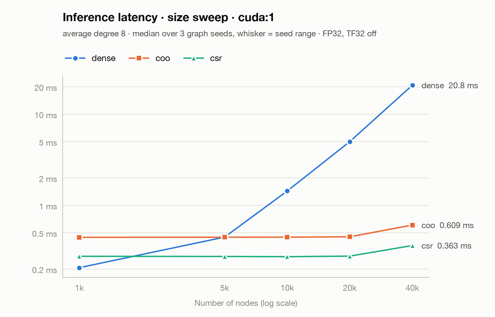
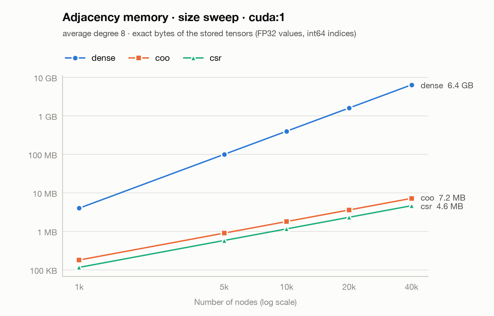
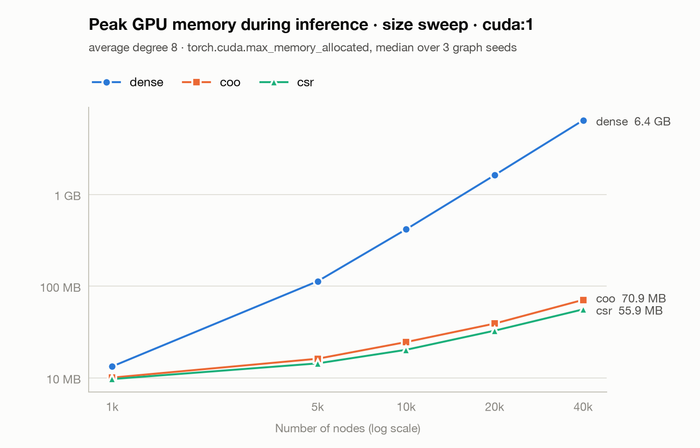
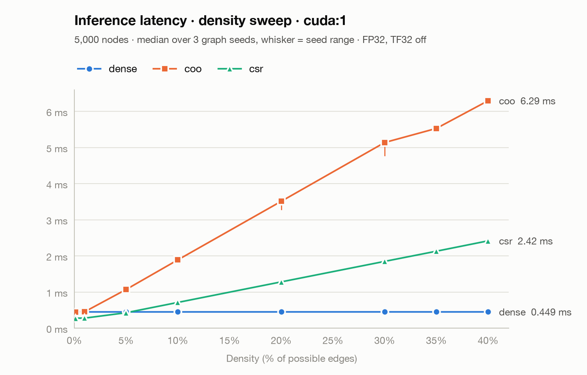
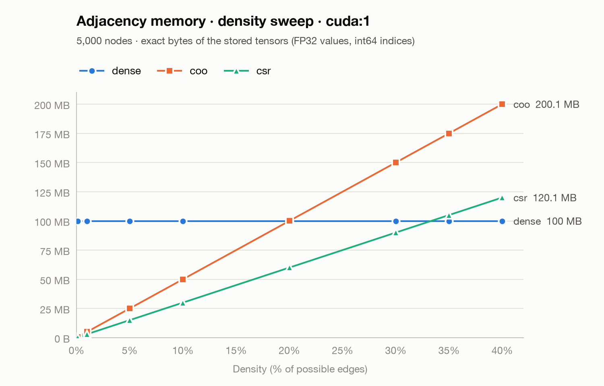
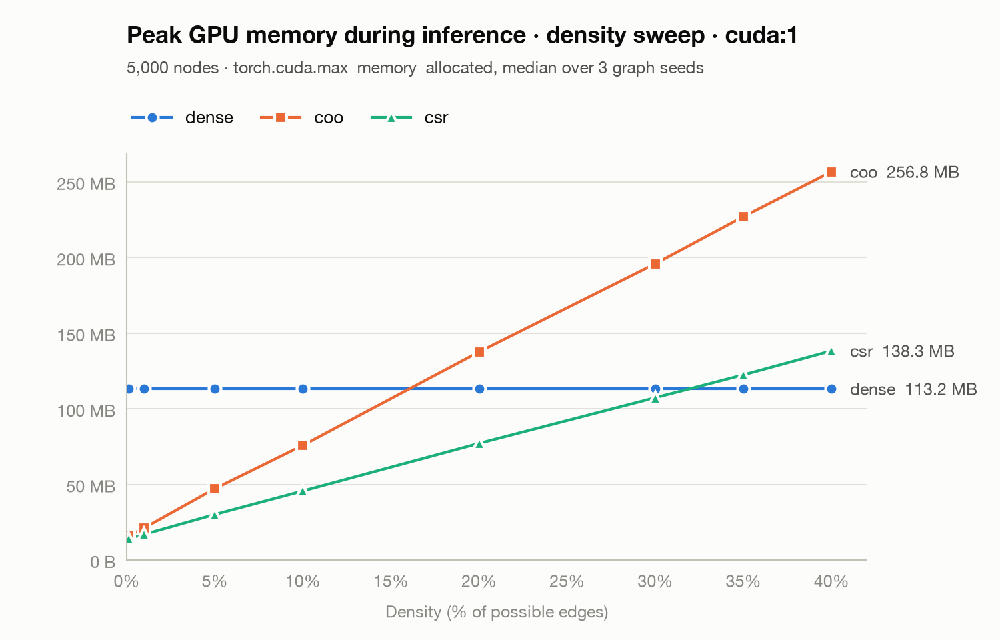

# Synthetic sweep results

Generated by `scripts/summarize_synthetic_results.py` from `results/synthetic`. Uniform random G(n, m) graphs, untrained two-layer GCN with fixed random weights, logits checked against COO on CPU. Latency and peak memory: median over graph seeds of the per-seed median, range = spread over seeds. Crossover estimates interpolate between neighboring sweep points.

## pilot_cuda1

Device: cuda:1. 9 runs.

### Graphs

| Nodes | Edges (m) | Avg degree | Density | nnz(Â) | Graph seeds | Same graph in every format |
|:---|---:|---:|---:|---:|---:|---:|
| 1,000 | 4,000 | 8.00 | 0.801% | 9,000 | 42 | yes |

### Latency (ms)

| Graph | dense | coo | csr | Fastest |
|:---|---:|---:|---:|---:|
| 1,000 | 0.207 | 0.447 | 0.276 | dense |

### Adjacency memory

| Graph | dense | coo | csr | Smallest |
|:---|---:|---:|---:|---:|
| 1,000 | 4.0 MB | 180.0 KB | 116.0 KB | csr |

### Peak GPU memory

| Graph | dense | coo | csr | Smallest |
|:---|---:|---:|---:|---:|
| 1,000 | 13.3 MB | 10.1 MB | 9.7 MB | csr |

### Equivalence

| Graph | Max \|Δlogit\| dense | Max \|Δlogit\| coo | Max \|Δlogit\| csr | Runs | All equivalent |
|:---|---:|---:|---:|---:|---:|
| 1,000 | 3.3e-07 | 3.3e-07 | 3.3e-07 | 9 | yes |

All runs equivalent to the CPU COO reference: yes (allclose atol=1e-5, rtol=1e-4, 100% argmax agreement)

## size_cuda1

Device: cuda:1. 135 runs.

### Graphs

| Nodes | Edges (m) | Avg degree | Density | nnz(Â) | Graph seeds | Same graph in every format |
|:---|---:|---:|---:|---:|---:|---:|
| 1,000 | 4,000 | 8.00 | 0.801% | 9,000 | 42, 43, 44 | yes |
| 5,000 | 20,000 | 8.00 | 0.16% | 45,000 | 42, 43, 44 | yes |
| 10,000 | 40,000 | 8.00 | 0.08% | 90,000 | 42, 43, 44 | yes |
| 20,000 | 80,000 | 8.00 | 0.04% | 180,000 | 42, 43, 44 | yes |
| 40,000 | 160,000 | 8.00 | 0.02% | 360,000 | 42, 43, 44 | yes |

### Latency (ms)

| Nodes | dense | coo | csr | Fastest |
|:---|---:|---:|---:|---:|
| 1,000 | 0.207 (0.204–0.209) | 0.446 (0.445–0.447) | 0.276 (0.275–0.278) | dense |
| 5,000 | 0.449 (0.449–0.449) | 0.447 (0.446–0.449) | 0.275 (0.274–0.275) | csr |
| 10,000 | 1.438 (1.431–1.438) | 0.448 (0.446–0.448) | 0.274 (0.273–0.277) | csr |
| 20,000 | 5.006 (5.000–5.019) | 0.452 (0.452–0.456) | 0.278 (0.275–0.278) | csr |
| 40,000 | 20.820 (20.818–20.878) | 0.609 (0.607–0.609) | 0.363 (0.363–0.363) | csr |

### Adjacency memory

| Nodes | dense | coo | csr | Smallest |
|:---|---:|---:|---:|---:|
| 1,000 | 4.0 MB | 180.0 KB | 116.0 KB | csr |
| 5,000 | 100.0 MB | 900.0 KB | 580.0 KB | csr |
| 10,000 | 400.0 MB | 1.8 MB | 1.2 MB | csr |
| 20,000 | 1.6 GB | 3.6 MB | 2.3 MB | csr |
| 40,000 | 6.4 GB | 7.2 MB | 4.6 MB | csr |

### Peak GPU memory

| Nodes | dense | coo | csr | Smallest |
|:---|---:|---:|---:|---:|
| 1,000 | 13.3 MB | 10.1 MB | 9.7 MB | csr |
| 5,000 | 113.2 MB | 16.2 MB | 14.4 MB | csr |
| 10,000 | 417.1 MB | 24.6 MB | 20.3 MB | csr |
| 20,000 | 1.6 GB | 39.1 MB | 32.7 MB | csr |
| 40,000 | 6.4 GB | 70.9 MB | 55.9 MB | csr |

### Equivalence

| Nodes | Max \|Δlogit\| dense | Max \|Δlogit\| coo | Max \|Δlogit\| csr | Runs | All equivalent |
|:---|---:|---:|---:|---:|---:|
| 1,000 | 3.3e-07 | 3.3e-07 | 3.3e-07 | 27 | yes |
| 5,000 | 2.4e-07 | 2.4e-07 | 2.4e-07 | 27 | yes |
| 10,000 | 4.8e-07 | 4.8e-07 | 4.8e-07 | 27 | yes |
| 20,000 | 6.0e-07 | 6.0e-07 | 6.0e-07 | 27 | yes |
| 40,000 | 4.8e-07 | 4.8e-07 | 4.8e-07 | 27 | yes |

All runs equivalent to the CPU COO reference: yes (allclose atol=1e-5, rtol=1e-4, 100% argmax agreement)

### Crossovers with dense

| Metric | Format | Crosses dense | Estimate | Better than dense |
|:---|---:|---:|---:|---:|
| Latency | coo | between 1,000 and 10,000 | tied at 5,000 | above the crossover |
| Latency | csr | between 1,000 and 5,000 | ≈ 1,600 | above the crossover |
| Adjacency bytes | coo | not in this range | - | at every point |
| Adjacency bytes | csr | not in this range | - | at every point |
| Peak GPU memory | coo | not in this range | - | at every point |
| Peak GPU memory | csr | not in this range | - | at every point |

Estimates interpolate between the two neighboring sweep points in log(nodes). Differences under 2% of dense count as ties.

## density_cuda1

Device: cuda:1. 216 runs.

### Graphs

| Nodes | Edges (m) | Avg degree | Density | nnz(Â) | Graph seeds | Same graph in every format |
|:---|---:|---:|---:|---:|---:|---:|
| 5,000 | 12,498 | 5.00 | 0.1% | 29,996 | 42, 43, 44 | yes |
| 5,000 | 124,975 | 49.99 | 1% | 254,950 | 42, 43, 44 | yes |
| 5,000 | 624,875 | 249.95 | 5% | 1,254,750 | 42, 43, 44 | yes |
| 5,000 | 1,249,750 | 499.90 | 10% | 2,504,500 | 42, 43, 44 | yes |
| 5,000 | 2,499,500 | 999.80 | 20% | 5,004,000 | 42, 43, 44 | yes |
| 5,000 | 3,749,250 | 1499.70 | 30% | 7,503,500 | 42, 43, 44 | yes |
| 5,000 | 4,374,125 | 1749.65 | 35% | 8,753,250 | 42, 43, 44 | yes |
| 5,000 | 4,999,000 | 1999.60 | 40% | 10,003,000 | 42, 43, 44 | yes |

### Latency (ms)

| Density | dense | coo | csr | Fastest |
|:---|---:|---:|---:|---:|
| 0.1% | 0.449 (0.449–0.449) | 0.448 (0.448–0.449) | 0.276 (0.272–0.278) | csr |
| 1% | 0.449 (0.449–0.449) | 0.453 (0.453–0.456) | 0.277 (0.277–0.277) | csr |
| 5% | 0.449 (0.448–0.449) | 1.069 (1.068–1.070) | 0.426 (0.426–0.426) | csr |
| 10% | 0.449 (0.449–0.449) | 1.889 (1.888–1.889) | 0.711 (0.710–0.712) | dense |
| 20% | 0.449 (0.449–0.449) | 3.510 (3.290–3.511) | 1.280 (1.280–1.280) | dense |
| 30% | 0.449 (0.449–0.449) | 5.138 (4.783–5.138) | 1.848 (1.848–1.849) | dense |
| 35% | 0.449 (0.448–0.450) | 5.528 (5.528–5.529) | 2.129 (2.128–2.129) | dense |
| 40% | 0.449 (0.449–0.450) | 6.294 (6.293–6.295) | 2.416 (2.416–2.417) | dense |

### Adjacency memory

| Density | dense | coo | csr | Smallest |
|:---|---:|---:|---:|---:|
| 0.1% | 100.0 MB | 599.9 KB | 400.0 KB | csr |
| 1% | 100.0 MB | 5.1 MB | 3.1 MB | csr |
| 5% | 100.0 MB | 25.1 MB | 15.1 MB | csr |
| 10% | 100.0 MB | 50.1 MB | 30.1 MB | csr |
| 20% | 100.0 MB | 100.1 MB | 60.1 MB | csr |
| 30% | 100.0 MB | 150.1 MB | 90.1 MB | csr |
| 35% | 100.0 MB | 175.1 MB | 105.1 MB | dense |
| 40% | 100.0 MB | 200.1 MB | 120.1 MB | dense |

### Peak GPU memory

| Density | dense | coo | csr | Smallest |
|:---|---:|---:|---:|---:|
| 0.1% | 113.2 MB | 15.8 MB | 14.2 MB | csr |
| 1% | 113.2 MB | 21.2 MB | 17.0 MB | csr |
| 5% | 113.2 MB | 47.2 MB | 30.1 MB | csr |
| 10% | 113.2 MB | 75.8 MB | 45.7 MB | csr |
| 20% | 113.2 MB | 137.6 MB | 77.1 MB | csr |
| 30% | 113.2 MB | 195.9 MB | 107.3 MB | csr |
| 35% | 113.2 MB | 227.0 MB | 122.4 MB | dense |
| 40% | 113.2 MB | 256.8 MB | 138.3 MB | dense |

### Equivalence

| Density | Max \|Δlogit\| dense | Max \|Δlogit\| coo | Max \|Δlogit\| csr | Runs | All equivalent |
|:---|---:|---:|---:|---:|---:|
| 0.1% | 4.8e-07 | 4.8e-07 | 4.8e-07 | 27 | yes |
| 1% | 8.9e-08 | 8.9e-08 | 8.9e-08 | 27 | yes |
| 5% | 8.2e-08 | 7.5e-08 | 8.2e-08 | 27 | yes |
| 10% | 7.1e-08 | 6.7e-08 | 6.3e-08 | 27 | yes |
| 20% | 8.2e-08 | 7.5e-08 | 7.8e-08 | 27 | yes |
| 30% | 6.3e-08 | 7.1e-08 | 6.3e-08 | 27 | yes |
| 35% | 7.1e-08 | 7.8e-08 | 6.9e-08 | 27 | yes |
| 40% | 7.5e-08 | 8.0e-08 | 8.2e-08 | 27 | yes |

All runs equivalent to the CPU COO reference: yes (allclose atol=1e-5, rtol=1e-4, 100% argmax agreement)

### Crossovers with dense

| Metric | Format | Crosses dense | Estimate | Better than dense |
|:---|---:|---:|---:|---:|
| Latency | coo | not in this range | - | at no point (tied at 0.1%, 1%) |
| Latency | csr | between 5% and 10% | ≈ 5.4% | below the crossover |
| Adjacency bytes | coo | between 10% and 30% | tied at 20% | below the crossover |
| Adjacency bytes | csr | between 30% and 35% | ≈ 33% | below the crossover |
| Peak GPU memory | coo | between 10% and 20% | ≈ 16% | below the crossover |
| Peak GPU memory | csr | between 30% and 35% | ≈ 32% | below the crossover |

Estimates interpolate between the two neighboring sweep points. Differences under 2% of dense count as ties.
